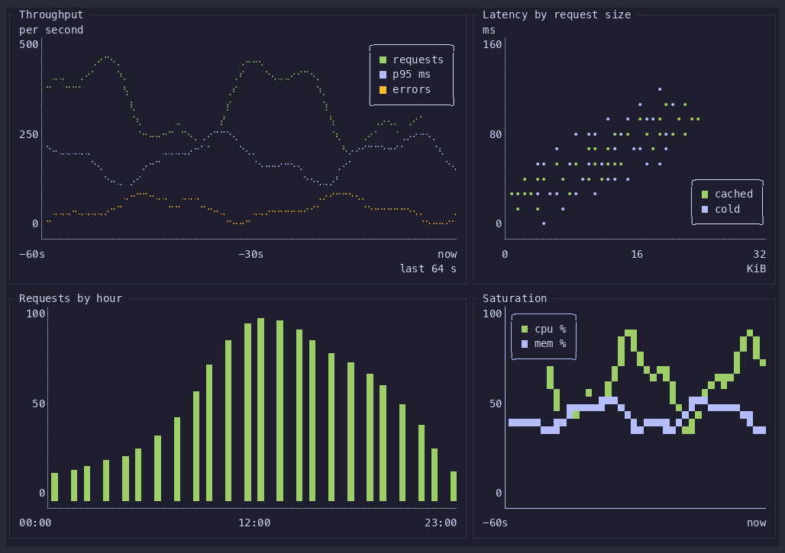
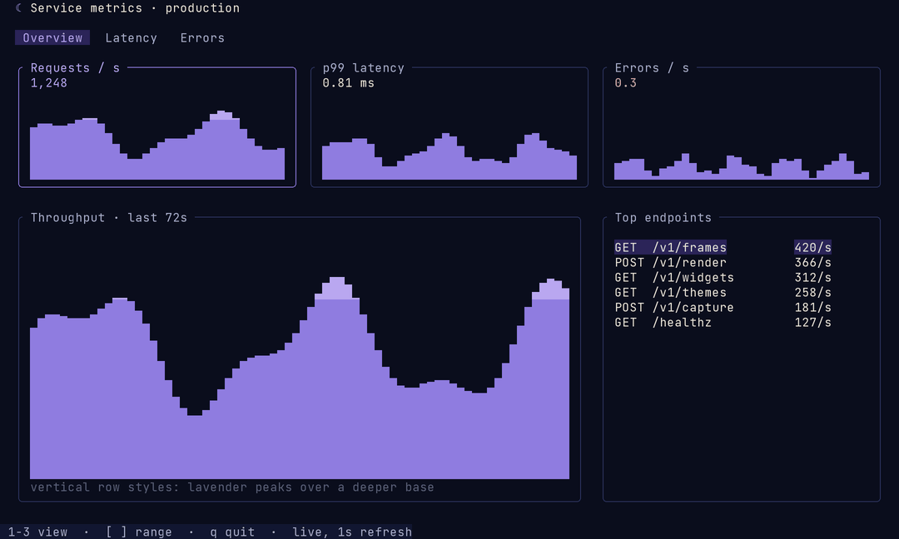
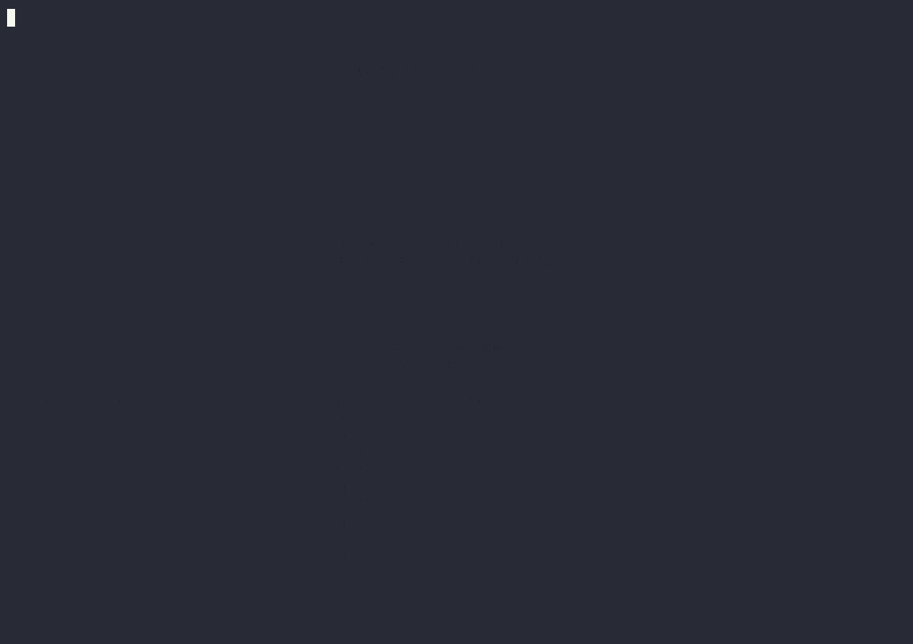
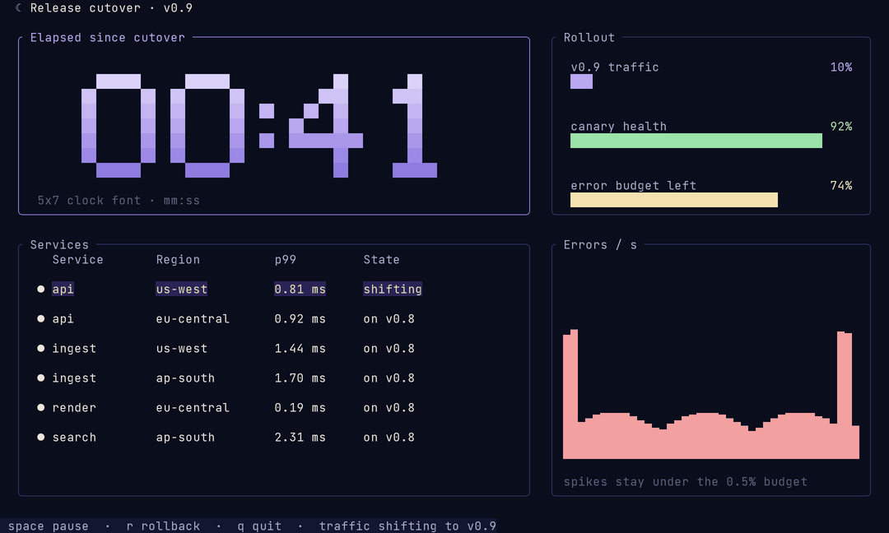

# lunatui

lunatui is a hyperspeed Rust TUI library being built from scratch, keeping a simple "render widgets into a rectangle" model while fixing its structural costs with a 16-byte packed cell, damage-tracked diffing and a single-write output encoder, plus first-class input, focus, animation, capability and theme layers. It is open source under the [MIT](LICENSE) license.

**Status: v0.1.13 preview** — first usable release on the roadmap (Phase 4 widgets, encoder, runtime, tests). APIs and backends still evolve before 1.0. Start with [Getting started](docs/getting-started.md), the [architecture overview](docs/architecture.md), and the [PRD](docs/PRD.md).

## Performance

Lunatui's own dashboard numbers on one machine (Apple M5 Max, release build), median of five runs of 240 frames at 80×24:

| Size | Median frame | p95 | Allocations per frame | Bytes written per frame |
|---|---|---|---|---|
| 80×24 | 60 µs | 65 µs | ≈39 | 603 |
| 200×60 | 249 µs | 285 µs | ≈69 | 2868 |

Method and limits: [docs/performance.md](docs/performance.md).

## Quick start

```sh
git clone https://github.com/moonbase2090/lunatui
cd lunatui
cargo run --example live_dashboard
```

The dashboard draws 240 frames (about four seconds) and exits. Add `-- --bench` for a headless timing run. More examples are listed in [examples/README.md](examples/README.md).

See the [review policy](REVIEW_POLICY.md) for PR classification, proof and merge requirements.

Migration guide: [docs/porting-from-ratatui.md](docs/porting-from-ratatui.md). CI and manual sign-off: [docs/ci.md](docs/ci.md). Examples: [examples/README.md](examples/README.md).

## Widget gallery

Still frames and short recordings from `scripts/record-showcase.sh`: lunatui only, dark theme, 120×36.

### Chart

An operations dashboard with four charts: braille lines with a legend, a dot scatter, hourly bars, and a half-block line chart in the focused state. The series scroll and the points drift while the axes, labels, and titles stay put.



Screenshot: [docs/media/chart.png](docs/media/chart.png). Recorded with `scripts/record-showcase.sh` (`CASE=chart`, 120×36, `FRAMES=200`, dark, about 11 seconds).

### BarChart

A deploy dashboard made of five bar charts: grouped vertical bars with value text and group labels, horizontal bars with region labels, a series of build times with the latest run highlighted, and the same data in the normal, focused, and disabled states.


Screenshot: [docs/media/barchart.png](docs/media/barchart.png). Recorded with `scripts/record-showcase.sh` (`CASE=barchart`, 120×36, `FRAMES=200`, dark, about 11 seconds).

### MarkdownView

A docs reader: a page list beside a scrolling Markdown view, with headings and rules, hanging-indent lists, task items, quotes, code blocks, boxed tables, inline emphasis, code, and underlined links, and a scrollbar sized from the document. The reader moves through three pages.


Screenshot: [docs/media/markdown.png](docs/media/markdown.png). Recorded with `scripts/record-showcase.sh` (`CASE=markdown`, 120×36 at 2x scale, `FRAMES=218`, dark, lossless animated WebP, about 11 seconds).

### Breadcrumbs

A file browser: descending through six directories changes the file list, sizes, dates, preview, and visited trail at each step, the path bar narrows until its middle collapses to `…` and widens again, the segment under the pointer is underlined, and a click on `Projects` jumps back up the path.


Screenshot: [docs/media/breadcrumbs.png](docs/media/breadcrumbs.png). Recorded with `scripts/record-showcase.sh` (`CASE=breadcrumbs`, 120×36 at 2x scale, `FRAMES=240`, dark, lossless animated WebP, about 12 seconds).

### Split panes

A four-pane workspace (files, editor, terminal, inspector) whose dividers are dragged with the pointer: the grabbed divider is highlighted and the panes on both sides follow it one cell at a time, then the editor is zoomed to fill the screen and restored.


Screenshot: [docs/media/split.png](docs/media/split.png). Recorded with `scripts/record-showcase.sh` (`CASE=split`, 120×36 at 2x scale, `FRAMES=240`, dark, lossless animated WebP, about 12 seconds).

### Canvas

A monitoring wall drawn with Canvas: one radar ring and a smoothly rotating sweep, a live signal chart over a half-block filled area, and a route map with corridor rectangles, labeled waypoints, points, and a continuously moving marker. Lines and curves use braille's 2×4 sub-cell grid.


Screenshot: [docs/media/canvas.png](docs/media/canvas.png). Recorded with `scripts/record-showcase.sh` (`CASE=canvas`, 120×36, 240-frame run at 30 fps, dark, 2× scale, lossless animated WebP; 237 output frames at 24.5 fps over 9.68 seconds, all captured frames retained).

### Toast

A timed toast stack over an operations console: boxed toasts stack up in the corner of the pane they belong to, one-row status toasts stack on the bottom rows, and each goes away when its time is up, so a newer message sits above an older one and a status message sits above them all.


Screenshot: [docs/media/toast.png](docs/media/toast.png). Recorded with `scripts/record-showcase.sh` (`CASE=toast`, 120×36 at 2x scale, `FRAMES=240`, dark, lossless animated WebP, about 12 seconds).

### Tab reordering

A release pipelines screen with a boxed tab strip reordered by the pointer. Pressing a tab selects it and lifts it off the strip. While it follows the pointer, the other tabs slide aside and an empty slot marks where it will land. On release it settles into that slot, and the selection stays on it. Three drags run: Builds forward, Deploys to the front, and Logs to the end. Each tab shows live content: a builds table with a running build, deploys with a rollout in progress, and a streaming log.


Screenshot: [docs/media/tabs-drag.png](docs/media/tabs-drag.png). Recorded with `scripts/record-showcase.sh` (`CASE=tabs-drag`, 120×36 at 2x scale, `FRAMES=240`, dark, lossless animated WebP, about 12 seconds).

### Key hint bar

A release console whose bottom line is a `KeyHintBar` built from the keymap of the current mode: browsing shows move, open, search, publish, and quit; typing a search filter swaps it for apply, clear, and cancel; the publish confirmation shows yes, go back, and cancel. The bar redraws from whichever keymap is active, so it never lists a key that does nothing.


Screenshot: [docs/media/key-hints.png](docs/media/key-hints.png). Recorded with `scripts/record-showcase.sh` (`CASE=key-hints`, 120×36 at 2x scale, `FRAMES=240`, dark, lossless animated WebP, about 12 seconds).

### Sparkline

Live service board. Ten series scroll in eighth-block bars, the highlight moves from row to row, and the error series turns red while it is over its threshold.




Recorded with `scripts/record-showcase.sh` (`CASE=sparkline`, 120×36, 8 s at 30 fps, dark theme).

### Calendar

A team schedule: the month beside that day's agenda, colored release, review, on-call, and incident days, today held in a raised cell, and the selection walking from late October into November.



Screenshot: [docs/media/calendar.png](docs/media/calendar.png). Recorded with `scripts/record-widget.sh` (`CASE=calendar`, 120×36, dark, about 11 seconds).

### BigText

A cutover board: a live clock, a countdown that reaches zero, and ticking metrics. The selection moves, and the error count turns red while it is hot.



Screenshot: [docs/media/bigtext.png](docs/media/bigtext.png). Recorded with `scripts/record-showcase.sh` (`CASE=bigtext`, 120×36, dark, about 11 seconds).

### Image

A media library for an observatory archive. Each thumbnail is an `Image` with `ImageFit::Cover`. The selected one is drawn focused, and the two imports are drawn disabled until they finish. The preview switches between `ImageFit::Contain` and `ImageFit::Cover`, and the details panel shows each frame's tone bands. The pictures are the website's sky, hills and moon art, resized, tinted and layered by the example.


Screenshot: [docs/media/image-120x36-truecolor-dark.png](docs/media/image-120x36-truecolor-dark.png). Recorded with `scripts/record-widget.sh` (`CASE=image`, 120×36, dark, 10 seconds at 30 fps). The recording shows the half-block cell fallback, two image pixels per cell. The recorder captures terminal text and cannot capture Kitty graphics, so the Kitty path is not shown.
