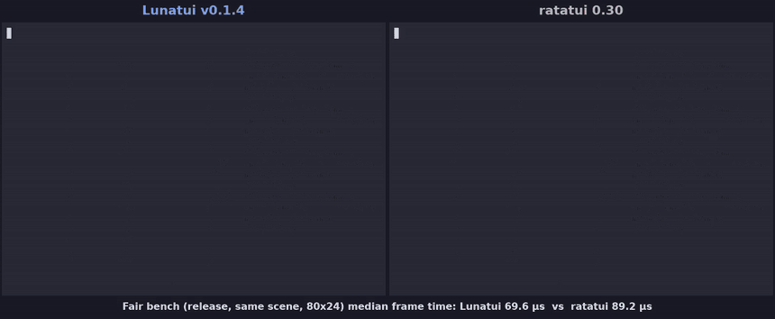

# lunatui

lunatui is a hyperspeed Rust TUI library being built from scratch to replace ratatui, keeping its simple "render widgets into a rectangle" model while fixing its structural costs with a 16-byte packed cell, damage-tracked diffing and a single-write output encoder, plus first-class input, focus, animation, capability and theme layers. It is open source under the [MIT](LICENSE) license.

**Status: v0.1.4 preview** — first usable release on the roadmap (Phase 4 widgets, encoder, runtime, tests). APIs and backends still evolve before 1.0. Start with [Getting started](docs/getting-started.md), the [architecture overview](docs/architecture.md), and the [PRD](docs/PRD.md).

## Lunatui vs ratatui



Same dashboard scene, 1500 frames at 80×24, recorded from the v0.1.4 release (GIF at 2× speed; [full-speed MP4](docs/media/lunatui-vs-ratatui.mp4)).

Fair dashboard benchmark (`scripts/run-dashboard-fair.sh`, 240 frames, median of 5 runs):

| Size | Median frame time (Lunatui / ratatui) | Allocs per frame (Lunatui / ratatui) | Bytes per frame (Lunatui / ratatui) |
|---|---|---|---|
| 80×24 | **69.6 µs** / 89.2 µs | **≈81** / ≈513 | 603 / **493** |
| 200×60 | **266.0 µs** / 296.4 µs | **≈163** / ≈881 | 2868 / **2636** |

Methodology: separate release binaries (`dashboard_fair_lunatui`, `dashboard_fair_ratatui`) render the same scene from identical model ticks on the same machine. Lunatui still writes more bytes per frame than ratatui in this scene.

## Quick start

```sh
git clone https://github.com/moonbase2090/lunatui
cd lunatui
cargo run --example live_dashboard
```

The dashboard draws 240 frames (about four seconds) and exits. Add `-- --bench` for a headless lunatui vs ratatui timing run. More examples are listed in [examples/README.md](examples/README.md).

See the [review policy](REVIEW_POLICY.md) for PR classification, proof and merge requirements.

## Performance vs ratatui (preview)

Same machine, same dashboard scene, same scripted frames, release builds, each side in its own process (median of five runs; Apple M5 Max). A test keeps the two scenes identical cell for cell. Full method, limits and reproduction: [docs/performance.md](docs/performance.md).

| Dashboard frame | ratatui 0.30.2 | lunatui |
|---|---|---|
| 80×24, median / p95 | 79 / 96 µs | **60 / 65 µs** |
| 200×60, median / p95 | 294 / 378 µs | **249 / 285 µs** |
| 200×60 bytes written | 3199 | **2868** |
| 200×60 `write()` calls | 3 | **1** |
| 200×60 allocations | 881 | **69** |
| Cell size | 48 B | **16 B** |

Frames are timed headless into a counting sink, so terminal latency is not measured, and the 200×60 lead is modest.

Porting notes: [docs/porting-from-ratatui.md](docs/porting-from-ratatui.md). CI and manual sign-off: [docs/ci.md](docs/ci.md). Examples: [examples/README.md](examples/README.md).
