# lunatui

lunatui is a hyperspeed Rust TUI library being built from scratch, keeping a simple "render widgets into a rectangle" model while fixing its structural costs with a 16-byte packed cell, damage-tracked diffing and a single-write output encoder, plus first-class input, focus, animation, capability and theme layers. It is open source under the [MIT](LICENSE) license.

**Status: v0.1.15 preview** — first usable release on the roadmap (Phase 4 widgets, encoder, runtime, tests). APIs and backends still evolve before 1.0. Start with [Getting started](docs/getting-started.md), the [architecture overview](docs/architecture.md), and the [PRD](docs/PRD.md).

## Performance

Lunatui's own dashboard numbers on one machine (Apple M5 Max, release build), median of five runs of 240 frames at 80×24:

| Size | Median frame | p95 | Allocations per frame | Bytes written per frame |
|---|---|---|---|---|
| 80×24 | 60 µs | 65 µs | ≈39 | 603 |
| 200×60 | 249 µs | 285 µs | ≈69 | 2868 |

Method and limits: [docs/performance.md](docs/performance.md).

## Quick start

Draw a first screen and quit on `q`. The steps and a program under 30 lines are in [Getting started](docs/getting-started.md). The crates are not on crates.io yet, so the commands run from this repository.

From this repository:

```sh
cargo run --example template_minimal
```

Six copy-paste templates (a list, a form, a dashboard, a popover, and a layout skeleton, plus the minimal app) are indexed in [examples/README.md](examples/README.md). `cargo run --example live_dashboard` still runs the longer dashboard demo.

See the [review policy](REVIEW_POLICY.md) for PR classification, proof and merge requirements.

Migration guide: [docs/porting-from-ratatui.md](docs/porting-from-ratatui.md). CI and manual sign-off: [docs/ci.md](docs/ci.md). Examples: [examples/README.md](examples/README.md).

## Widget gallery

Still frames and short recordings from `scripts/record-showcase.sh`: lunatui only, dark theme, 120×36.

### Chart

An operations dashboard with four charts: braille lines with a legend, a dot scatter, hourly bars, and a half-block line chart in the focused state. The series scroll and the points drift while the axes, labels, and titles stay put.

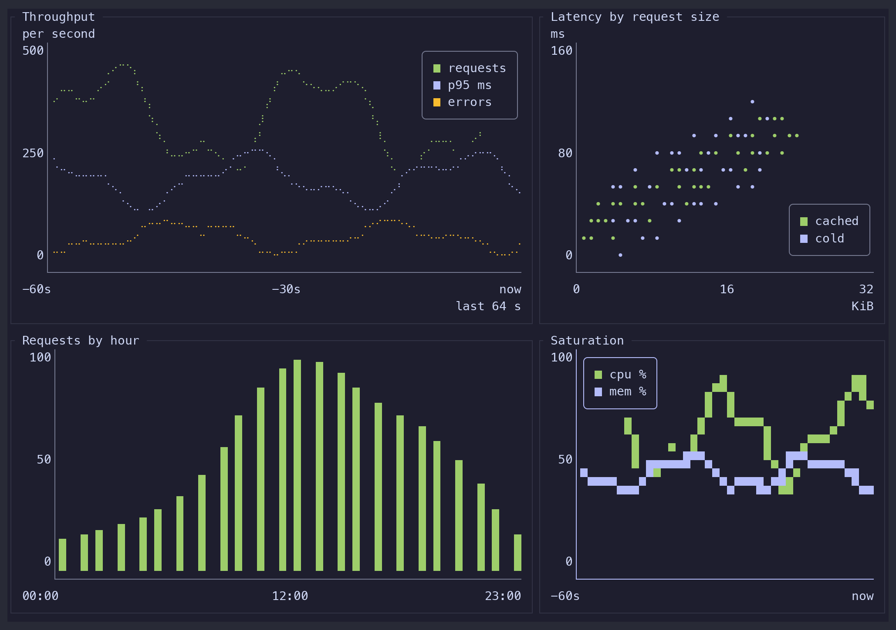

Screenshot: [docs/media/chart.png](docs/media/chart.png). Recorded with `scripts/record-showcase.sh` (`CASE=chart`, 120×36 at 2x scale, `FRAMES=200`, dark, lossless animated WebP, about 9 seconds).

### BarChart

A deploy dashboard made of five bar charts: grouped vertical bars with value text and group labels, horizontal bars with region labels, a series of build times with the latest run highlighted, and the same data in the normal, focused, and disabled states.

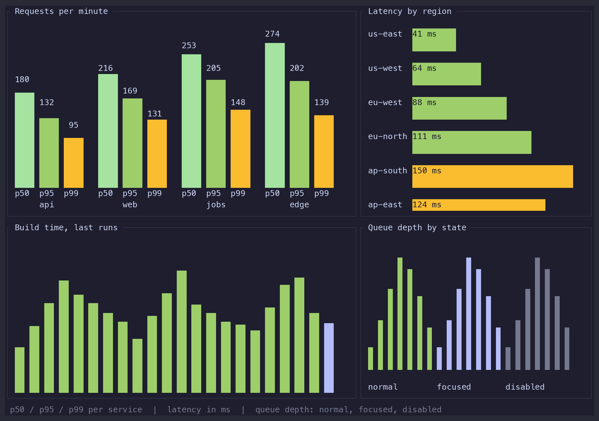

Screenshot: [docs/media/barchart.png](docs/media/barchart.png). Recorded with `scripts/record-showcase.sh` (`CASE=barchart`, 120×36 at 2x scale, `FRAMES=200`, dark, lossless animated WebP, about 9 seconds).

### MarkdownView

A docs reader: a page list beside a scrolling Markdown view, with headings and rules, hanging-indent lists, task items, quotes, code blocks, boxed tables, inline emphasis, code, and underlined links, and a scrollbar sized from the document. The reader moves through three pages.

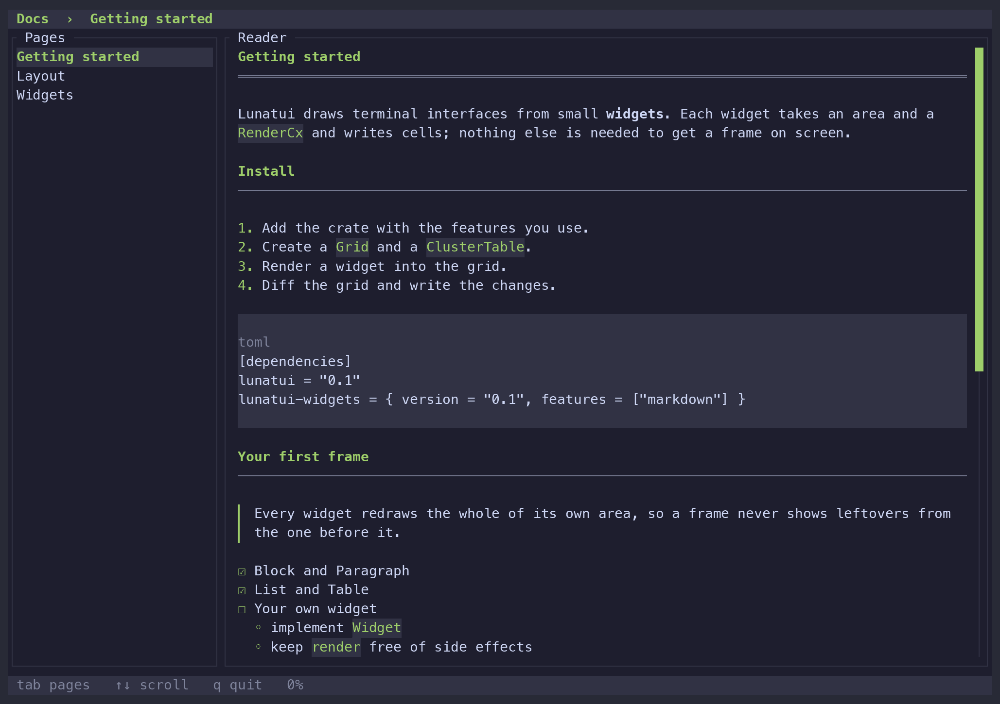

Screenshot: [docs/media/markdown.png](docs/media/markdown.png). Recorded with `scripts/record-showcase.sh` (`CASE=markdown`, 120×36 at 2x scale, `FRAMES=218`, dark, lossless animated WebP, about 11 seconds).

### Breadcrumbs

A file browser: descending through six directories changes the file list, sizes, dates, preview, and visited trail at each step, the path bar narrows until its middle collapses to `…` and widens again, the segment under the pointer is underlined, and a click on `Projects` jumps back up the path.

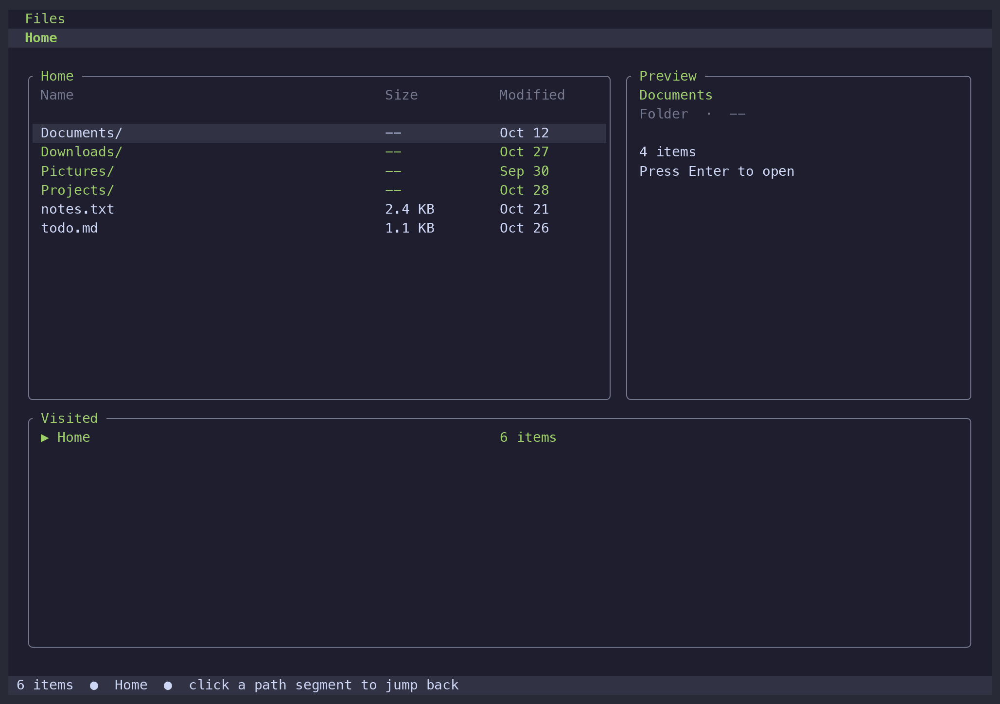

Screenshot: [docs/media/breadcrumbs.png](docs/media/breadcrumbs.png). Recorded with `scripts/record-showcase.sh` (`CASE=breadcrumbs`, 120×36 at 2x scale, `FRAMES=240`, dark, lossless animated WebP, about 12 seconds).

### Split panes

A four-pane workspace (files, editor, terminal, inspector) whose dividers are dragged with the pointer: the grabbed divider is highlighted and the panes on both sides follow it one cell at a time, then the editor is zoomed to fill the screen and restored.

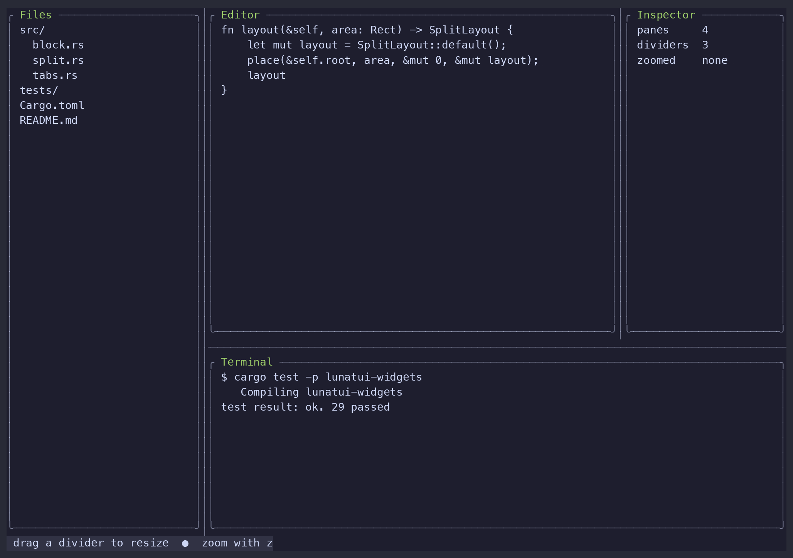

Screenshot: [docs/media/split.png](docs/media/split.png). Recorded with `scripts/record-showcase.sh` (`CASE=split`, 120×36 at 2x scale, `FRAMES=240`, dark, lossless animated WebP, about 12 seconds).

### Canvas

Six scenes drawn with Canvas, each in thin one-dot Braille strokes with no filled areas: an XY oscilloscope whose Lissajous figure glides between frequency ratios with a fading trail over a faint graticule, a slowly turning globe with great-circle flight paths and planes moving along them, CPU, memory, and network history as scrolling lines, an analog clock running at double time with a sweeping second hand beside a tree that grows branch by branch, a flock of 200 boids with short trails, and a world map with fading ping rings. Each frame is drawn for its own time on a fixed 60 fps step.

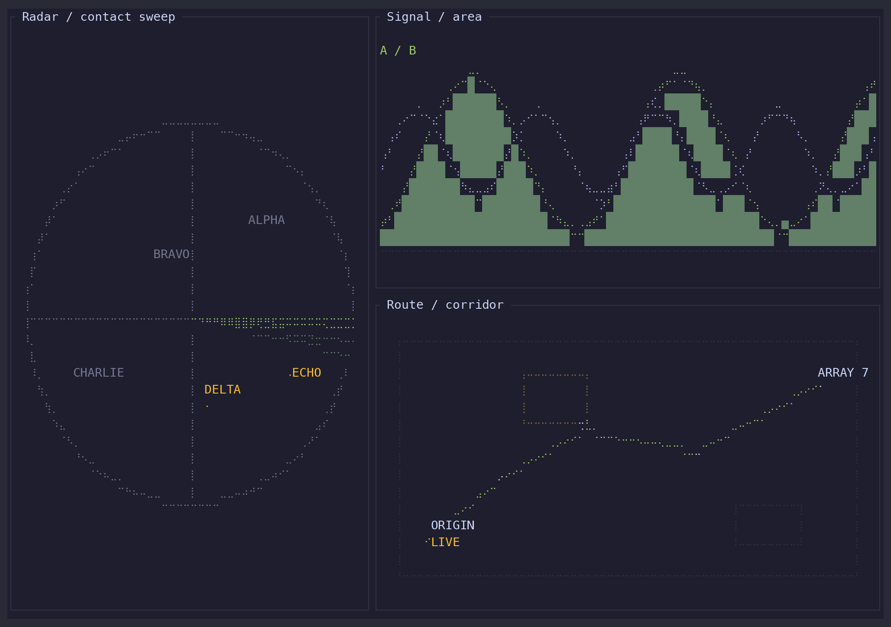

Screenshot: [docs/media/canvas.png](docs/media/canvas.png). Recorded with `scripts/record-showcase.sh` (`CASE=canvas FPS=60 FRAMES=321 HEIGHT=50 LINE_HEIGHT=1.0`, 120×50 at 60 fps, dark, 2× scale, lossless animated WebP, about 5.3 seconds plus a 2-second hold on the last frame; every frame is kept and shown for 16 or 17 ms). Coastlines are from Natural Earth (public domain).

### Toast

A timed toast stack over an operations console: boxed toasts stack up in the corner of the pane they belong to, one-row status toasts stack on the bottom rows, and each goes away when its time is up, so a newer message sits above an older one and a status message sits above them all.

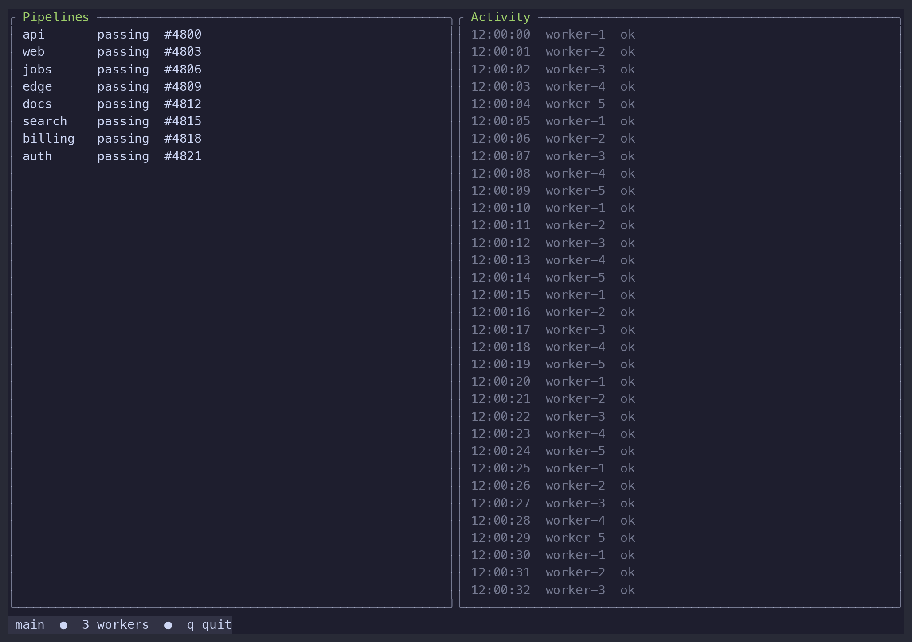

Screenshot: [docs/media/toast.png](docs/media/toast.png). Recorded with `scripts/record-showcase.sh` (`CASE=toast`, 120×36 at 2x scale, `FRAMES=240`, dark, lossless animated WebP, about 12 seconds).

### Tab reordering

A release pipelines screen with a boxed tab strip reordered by the pointer. Pressing a tab selects it and lifts it off the strip. While it follows the pointer, the other tabs slide aside and an empty slot marks where it will land. On release it settles into that slot, and the selection stays on it. Three drags run: Builds forward, Deploys to the front, and Logs to the end. Each tab shows live content: a builds table with a running build, deploys with a rollout in progress, and a streaming log.

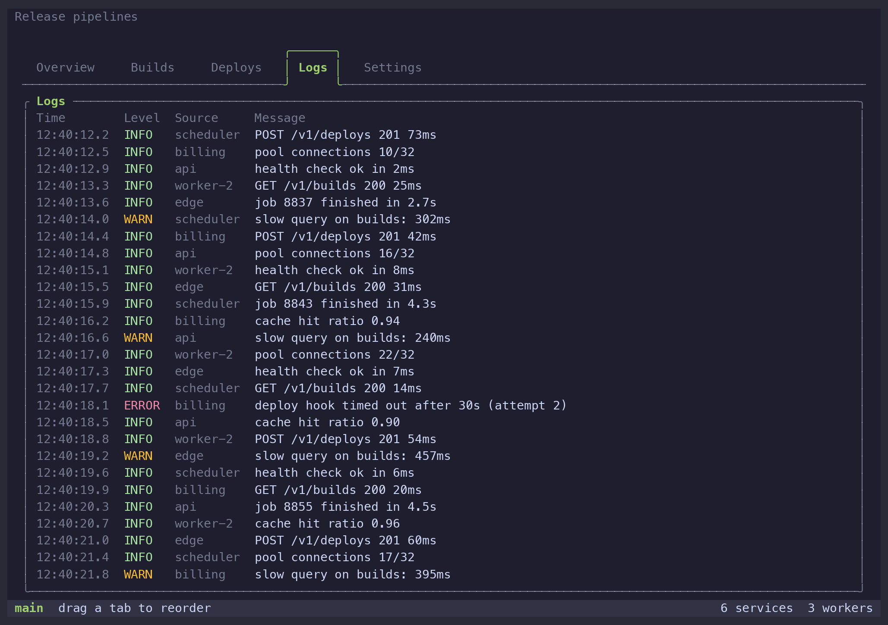

Screenshot: [docs/media/tabs-drag.png](docs/media/tabs-drag.png). Recorded with `scripts/record-showcase.sh` (`CASE=tabs-drag`, 120×36 at 2x scale, `FRAMES=240`, dark, lossless animated WebP, about 12 seconds).

### Key hint bar

A release console whose bottom line is a `KeyHintBar` built from the keymap of the current mode: browsing shows move, open, search, publish, and quit; typing a search filter swaps it for apply, clear, and cancel; the publish confirmation shows yes, go back, and cancel. The bar redraws from whichever keymap is active, so it never lists a key that does nothing.

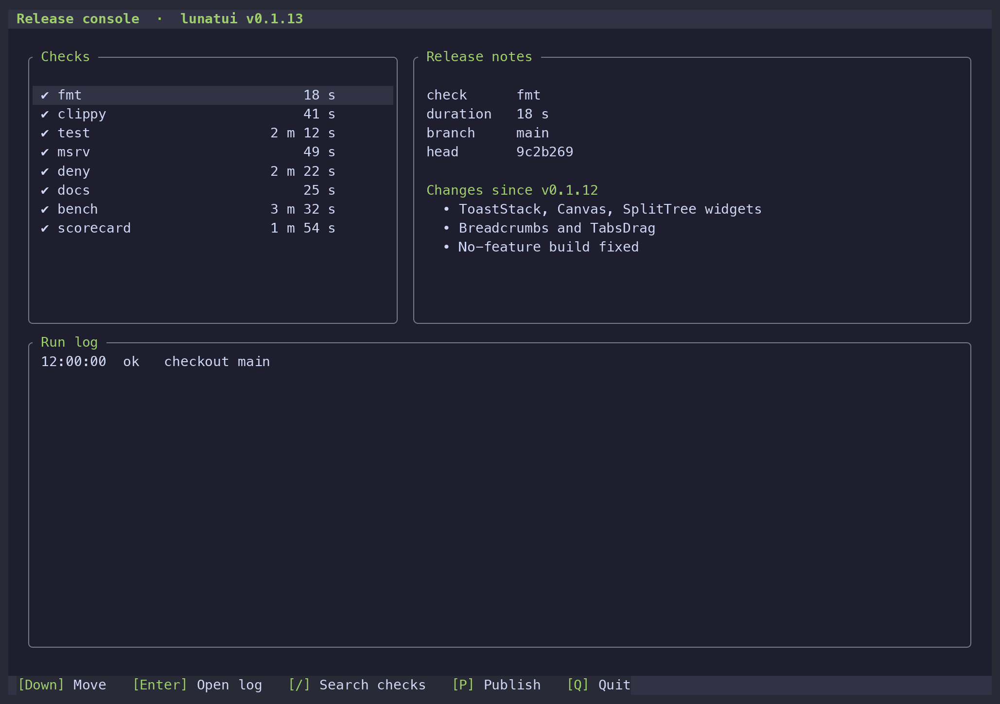

Screenshot: [docs/media/key-hints.png](docs/media/key-hints.png). Recorded with `scripts/record-showcase.sh` (`CASE=key-hints`, 120×36 at 2x scale, `FRAMES=240`, dark, lossless animated WebP, about 12 seconds).

### List icons and marks

A pull request list: a status icon before each title, a right-aligned number and area mark on every row, and a highlight symbol on the focused row whose band covers the whole row. The selection walks down the list, the list scrolls to keep it in view, a pull request changes state, and a new one arrives at the top.

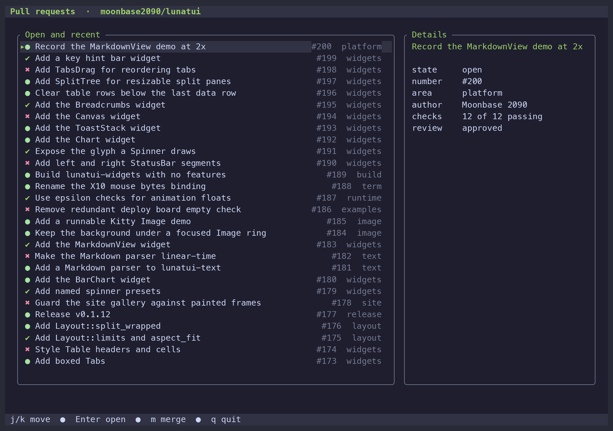

Screenshot: [docs/media/list-icons.png](docs/media/list-icons.png). Recorded with `scripts/record-showcase.sh` (`CASE=list-icons`, 120×36 at 2x scale, `FRAMES=240`, dark, lossless animated WebP, about 12 seconds).

### Toggle

A settings screen: switches in two groups, each with a one-line description, the focused switch drawn with a bold label and a focus-ring knob, and a live view of the settings file that changes as each switch flips. Focus moves through the switches and each one is toggled in turn, over two passes.

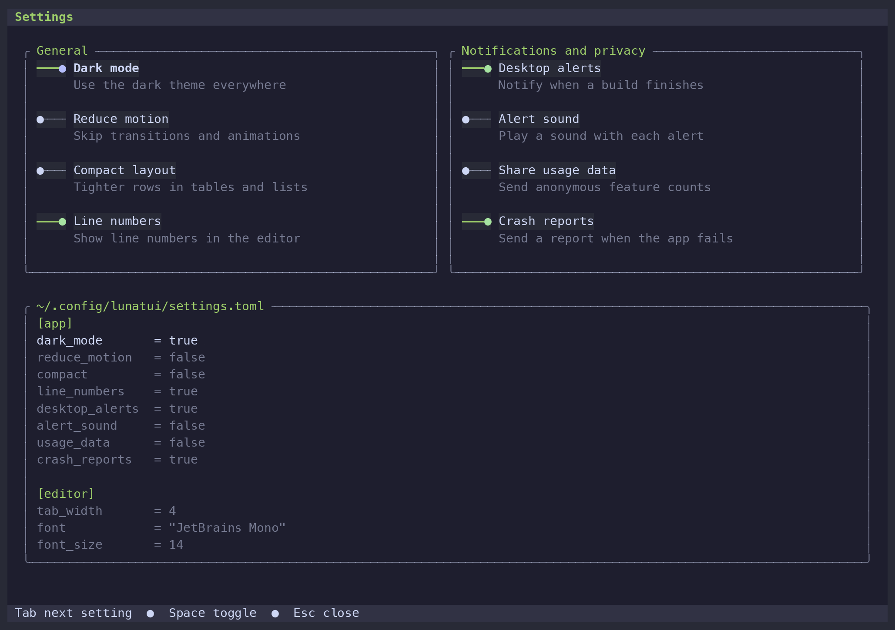

Screenshot: [docs/media/toggle.png](docs/media/toggle.png). Recorded with `scripts/record-showcase.sh` (`CASE=toggle`, 120×36 at 2x scale, `FRAMES=240`, dark, lossless animated WebP, about 12 seconds).

### Radio group

A preferences screen with three radio groups: a vertical theme list, a horizontal text size row, and an update channel with an option that is not available. The arrow keys step through each group in turn, skipping the disabled option and wrapping around; the focused group's title and option light up, and a preview pane follows every change.

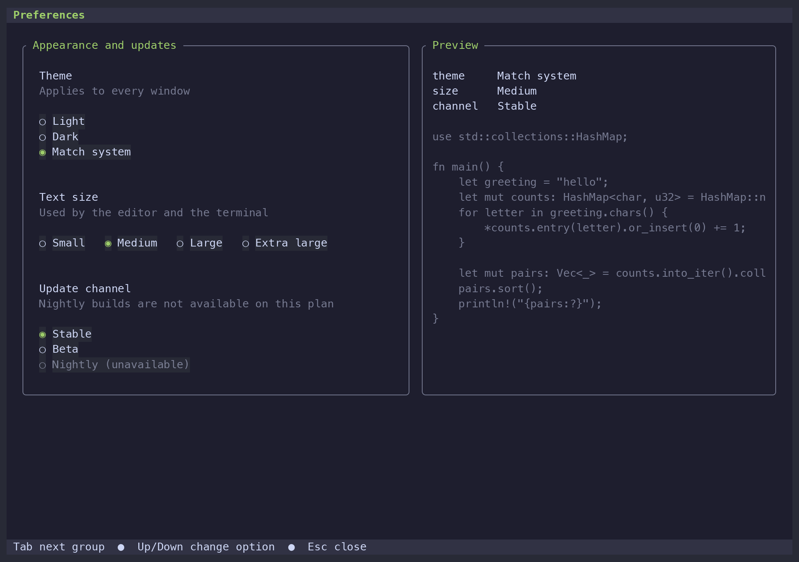

Screenshot: [docs/media/radio-group.png](docs/media/radio-group.png). Recorded with `scripts/record-showcase.sh` (`CASE=radio-group`, 120×36 at 2x scale, `FRAMES=240`, dark, lossless animated WebP, about 12 seconds).

### Form

An account form composed from widgets: a `Form` lays out labelled rows with required markers, hints, and validation messages, and the inputs are the caller's own widgets (text fields, a radio group, a toggle). Fields fill in as focus moves through them, a submit with missing or short values shows messages and jumps focus to the first one, and the messages clear as the fields are corrected.

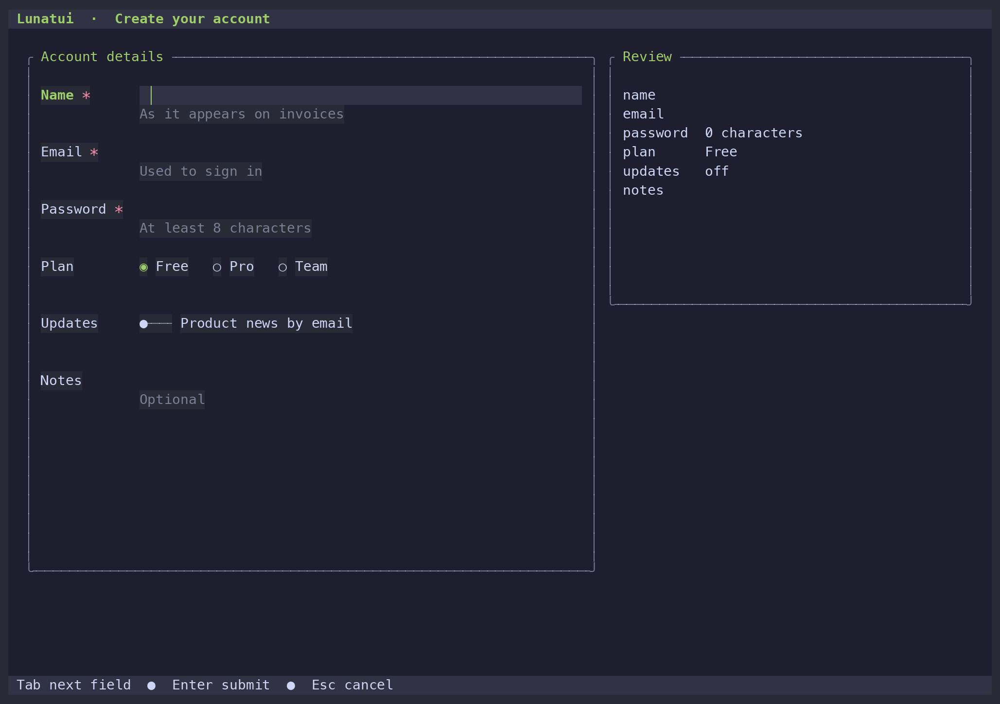

Screenshot: [docs/media/form.png](docs/media/form.png). Recorded with `scripts/record-showcase.sh` (`CASE=form`, 120×36 at 2x scale, `FRAMES=240`, dark, lossless animated WebP, about 12 seconds).

### Tooltip

An editor screen with a toolbar, a file tree, source with a warning in the gutter, and a status bar. The pointer rests on Save, Run and Settings, on the gutter warning, and on two status items, and each hint appears after a short delay: under the toolbar buttons, slid left at the right edge, beside the gutter with its message wrapped, and above the status bar where there is no room below. No hint covers what it points at.

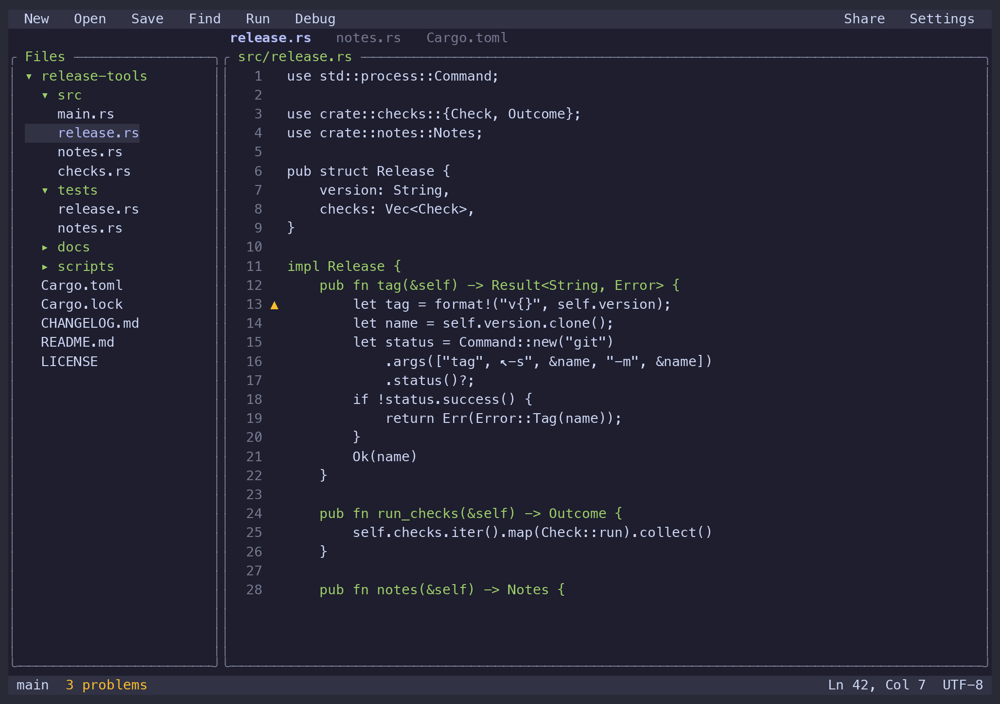

Screenshot: [docs/media/tooltip.png](docs/media/tooltip.png). Recorded with `scripts/record-showcase.sh` (`CASE=tooltip`, 120×36 at 2x scale, `FRAMES=270`, dark, lossless animated WebP, about 9 seconds plus a 2-second hold).

### PieChart

A cluster overview: a storage donut sweeps in with an eased reveal, then the highlight steps through each volume, pulling its slice out and following it in the legend and the detail line, while a high-resolution braille pie of requests by region redraws its shares every frame from live rates. The donut uses quadrant glyphs, so each cell can show two slices, and both charts keep their slice colors apart from each other in the dark, light, and 16-color palettes.

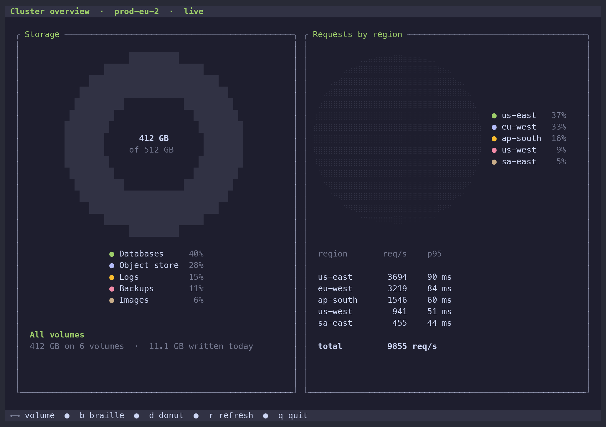

Screenshot: [docs/media/pie-chart.png](docs/media/pie-chart.png), plus the [light theme](docs/media/pie-chart-light.png) and the [16-color profile](docs/media/pie-chart-ansi16.png). Recorded with `scripts/record-showcase.sh` (`CASE=pie-chart`, 120×36 at 2x scale, `FRAMES=240`, dark, lossless animated WebP, about 10 seconds).

### HexViewer

A firmware inspector: the cursor walks the image header byte by byte, a shift-selection takes the four-byte version and then a section name, pages jump into the boot log strings and the vector table, and a mouse-wheel scroll moves the view while the cursor stays put. The viewer draws only the visible rows of a 4 KB image, colors bytes by kind, and the inspector pane reads the values under the cursor.

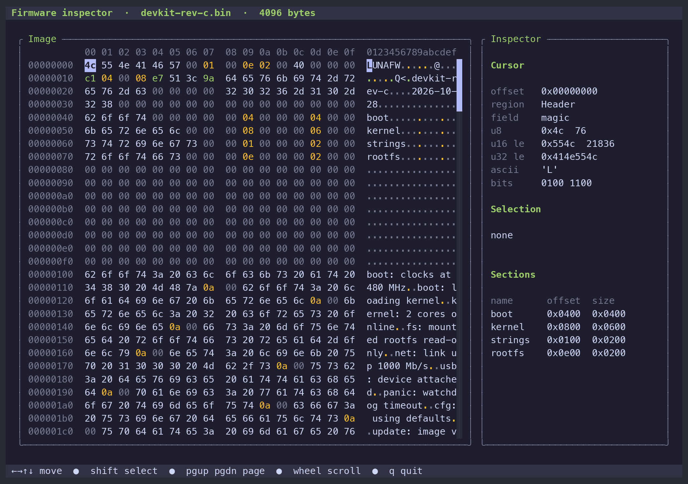

Screenshot: [docs/media/hex-viewer.png](docs/media/hex-viewer.png). Recorded with `scripts/record-showcase.sh` (`CASE=hex-viewer`, 120×36 at 2x scale, `FRAMES=240`, dark, lossless animated WebP, about 10 seconds).

### Progress bar

A release pipeline: a determinate bar for checkout, a stacked bar for compile (cached, compiled, and failed crates in their own colors), a stacked bar for the test suites (passed, skipped, failed), an indeterminate block bouncing along the track while the upload runs, and an overall bar with a percentage. The fill moves in eighths of a cell, and a cell where two segments meet shows both colors.

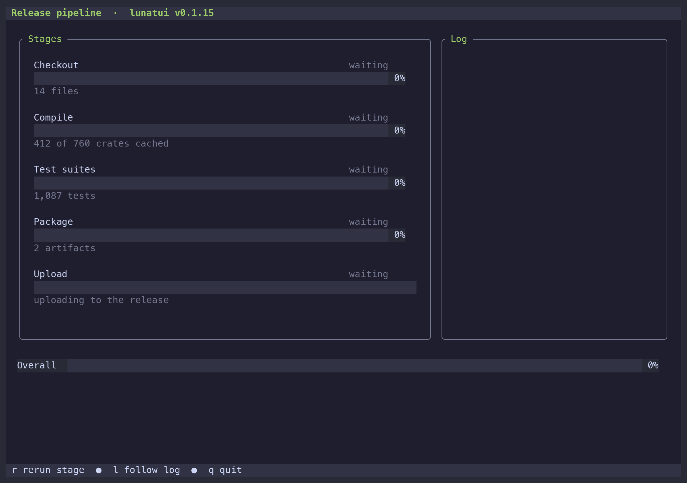

Screenshot: [docs/media/progress-bar.png](docs/media/progress-bar.png). Recorded with `scripts/record-showcase.sh` (`CASE=progress-bar`, 120×36 at 2x scale, `FRAMES=240`, dark, lossless animated WebP, about 12 seconds).
### Accordion

A pipeline settings screen: sections with a caret, a title, and a badge open and close one after another, each body growing and shrinking through a reveal fraction the app raises and lowers every tick. The accordion draws the headers and gives back the body rectangles, so the app fills them with its own content, and the summary pane follows the focused section.

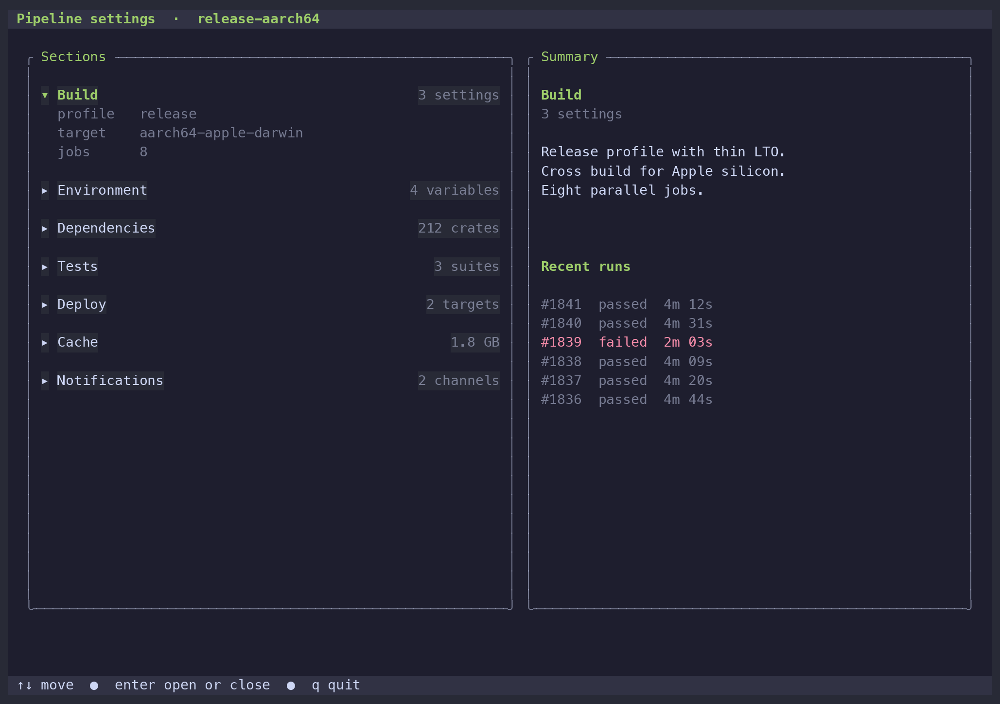

Screenshot: [docs/media/accordion.png](docs/media/accordion.png). Recorded with `scripts/record-showcase.sh` (`CASE=accordion`, 120×36 at 2x scale, `FRAMES=240`, dark, lossless animated WebP, about 12 seconds).
### Number input

A render queue's export settings: each field is a spin box with minus and plus buttons, a step, a range, and decimals, and the screen nudges them one after another while the estimate beside them follows. One field is typed by hand: the empty text shows in the fail color with a caret, digits arrive one at a time, and the committed value snaps to the field's decimals. The widget draws the field and gives back the rules (`nudge`, `parse`, `accepts`, `format`) and the button cells for the app's own key and mouse handling.

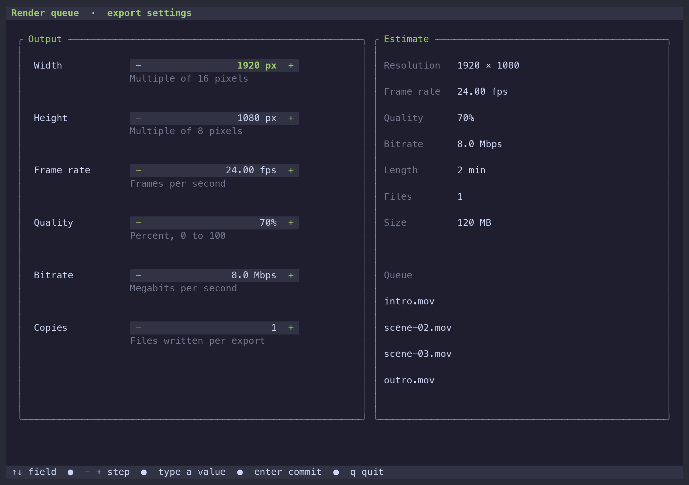

Screenshot: [docs/media/number-input.png](docs/media/number-input.png). Recorded with `scripts/record-showcase.sh` (`CASE=number-input`, 120×36 at 2x scale, `FRAMES=240`, dark, lossless animated WebP, about 10 seconds).

### Slider

A studio mixer: eight channel faders with a focus knob and the value beside each, four range sliders for equalizer bands whose two ends drift independently, and an output level that follows the master and music faders. The track fills with half-cell precision, so a fader moves in smaller steps than the cell grid, and the focused channel sweeps while the others hold their positions.

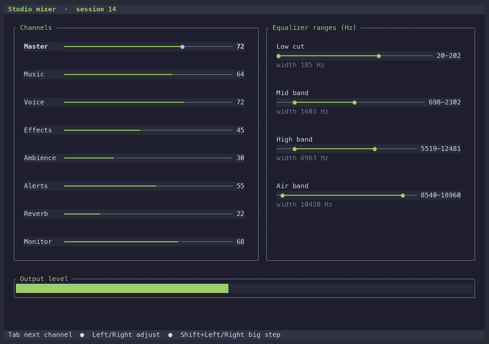

Screenshot: [docs/media/slider.png](docs/media/slider.png). Recorded with `scripts/record-showcase.sh` (`CASE=slider`, 120×36 at 2x scale, `FRAMES=240`, dark, lossless animated WebP, about 12 seconds).

### Diff view

A code review: a unified diff of a grid change with hunk headers, two line-number columns, removed and added lines in their own colors, and the changed part of each paired line inverted. It scrolls through both hunks, then switches to the side-by-side layout, where each removed line sits across from the line that replaced it.

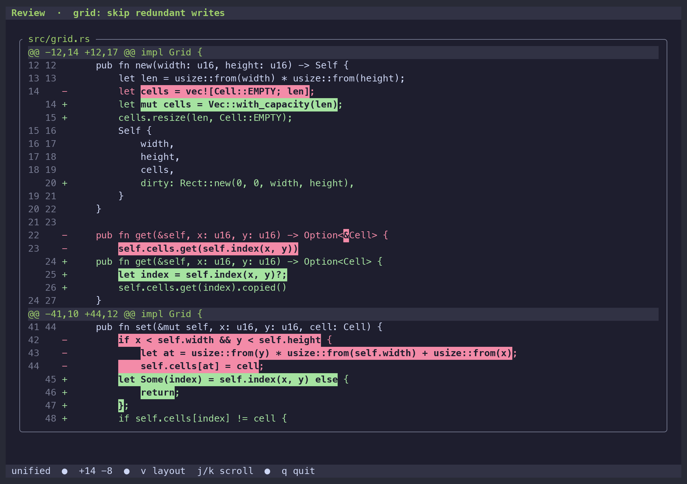

Screenshot: [docs/media/diff.png](docs/media/diff.png). Recorded with `scripts/record-showcase.sh` (`CASE=diff`, 120×36 at 2x scale, `FRAMES=240`, dark, lossless animated WebP, about 8 seconds).

### Log view

A service console: log lines stream into a ring buffer and scroll in from the bottom with a level label, a time, and a target column. The level filter then rises to warnings and errors, and a text filter keeps only the lines that mention the database, highlights the match, and scrolls back through the history before returning to follow the newest line.

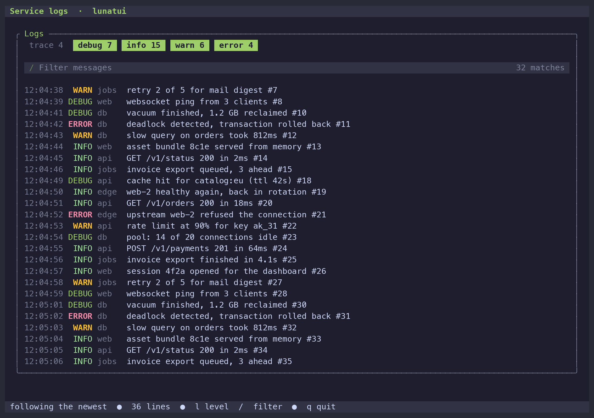

Screenshot: [docs/media/logs.png](docs/media/logs.png). Recorded with `scripts/record-showcase.sh` (`CASE=logs`, 120×36 at 2x scale, `FRAMES=240`, dark, lossless animated WebP, about 10 seconds).

### Search box

A widget catalog with live filtering: the query is typed one character at a time (and backspaced), the list narrows to the items that contain every term with the matched text highlighted, the count on the right follows, and `n` steps the active match with the details pane following it. The widget draws the field and hands back the rules (`filter` with smart case and match ranges, `step` through the matches, `put_highlighted` for drawing a row with its matches marked) and the clear button's cell for the app's own key and mouse handling.

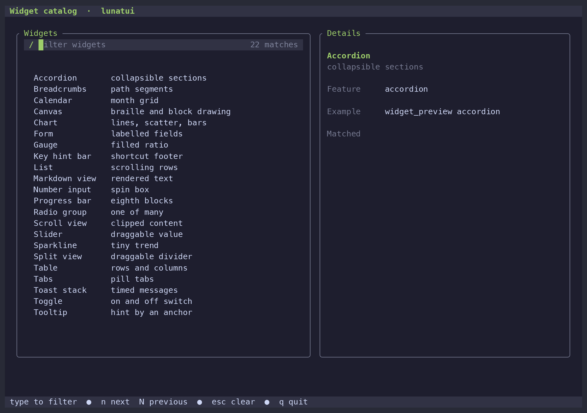

Screenshot: [docs/media/search-box.png](docs/media/search-box.png). Recorded with `scripts/record-showcase.sh` (`CASE=search-box`, 120×36 at 2x scale, `FRAMES=240`, dark, lossless animated WebP, about 10 seconds).

### Popover

A deploy console with a toolbar, a table of deploys and an activity log. Filter opens a status list under its button, and unticking queued drops those rows. A click on the table closes it. Sort, at the right edge, opens slid left to stay on screen, and choosing By service re-sorts the table. Columns hides the Version column, and Escape closes it. No popover covers its button.

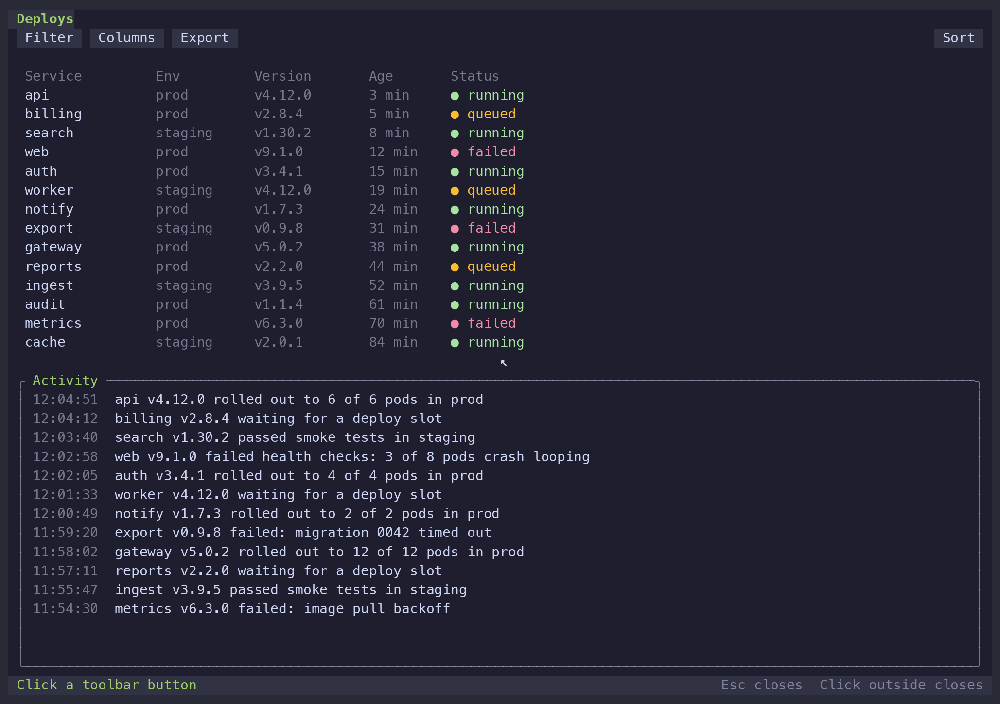

Screenshot: [docs/media/popover.png](docs/media/popover.png). Recorded with `scripts/record-showcase.sh` (`CASE=popover`, 120×36 at 2x scale, `FRAMES=240`, dark, lossless animated WebP, about 8 seconds plus a 2-second hold).

### Sparkline

Live service board. Ten series scroll in eighth-block bars, the highlight moves from row to row, and the error series turns red while it is over its threshold.

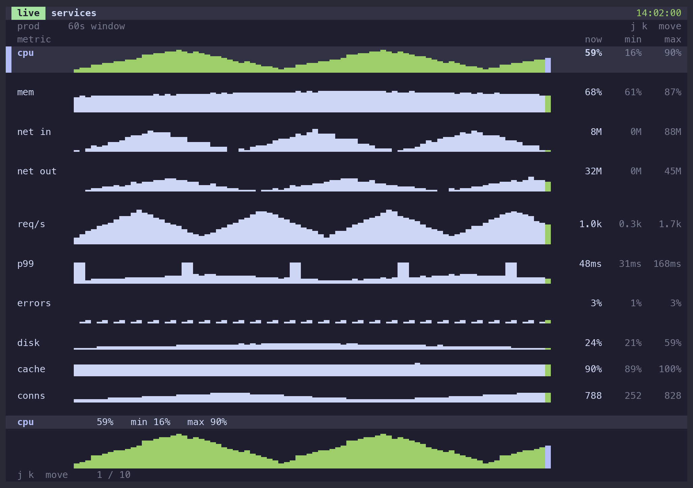

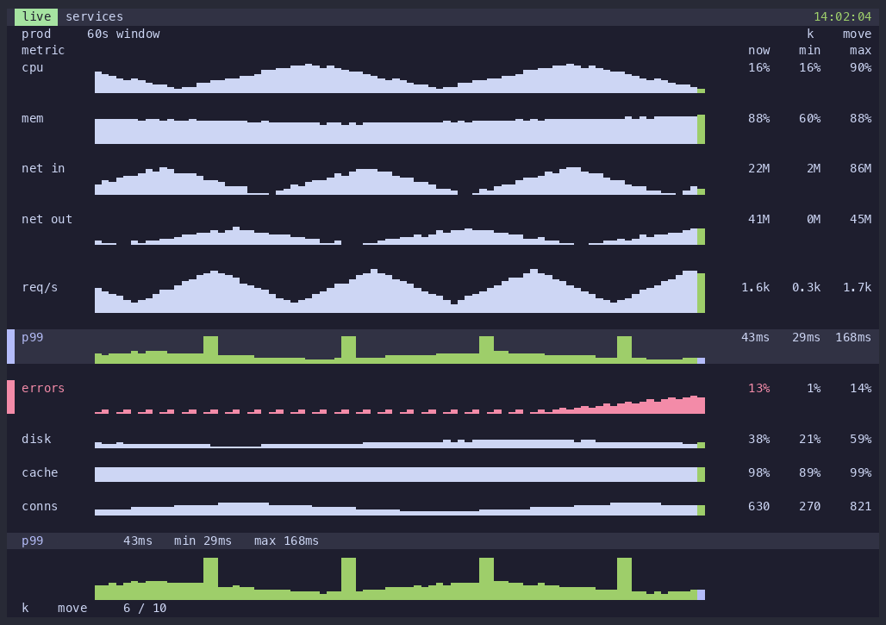

Recorded with `scripts/record-showcase.sh` (`CASE=sparkline`, 120×36 at 2x scale, `FRAMES=240`, dark, lossless animated WebP, about 10 seconds).

### Calendar

A team schedule: the month beside that day's agenda, colored release, review, on-call, and incident days, today held in a raised cell, and the selection walking from late October into November.

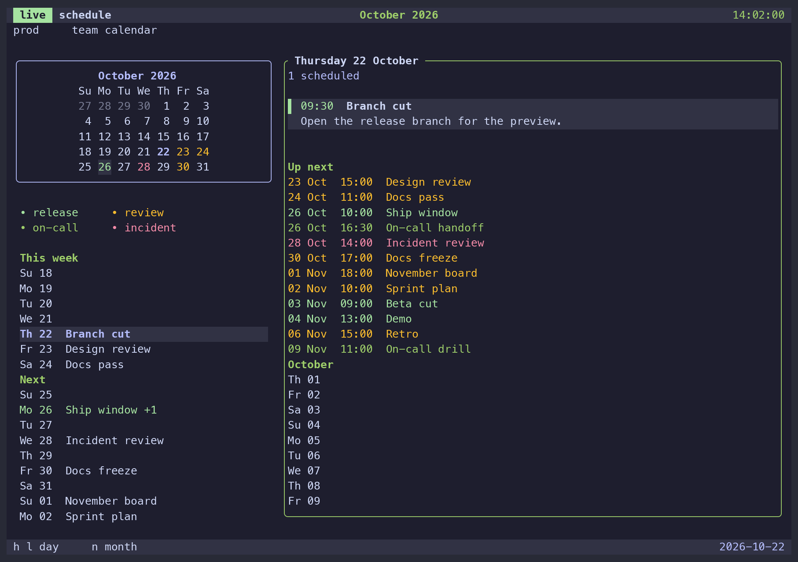

Screenshot: [docs/media/calendar.png](docs/media/calendar.png). Recorded with `scripts/record-showcase.sh` (`CASE=calendar`, 120×36 at 2x scale, `FRAMES=300`, dark, lossless animated WebP, about 12 seconds).

### BigText

A cutover board: a live clock, a countdown that reaches zero, and ticking metrics. The selection moves, and the error count turns red while it is hot.

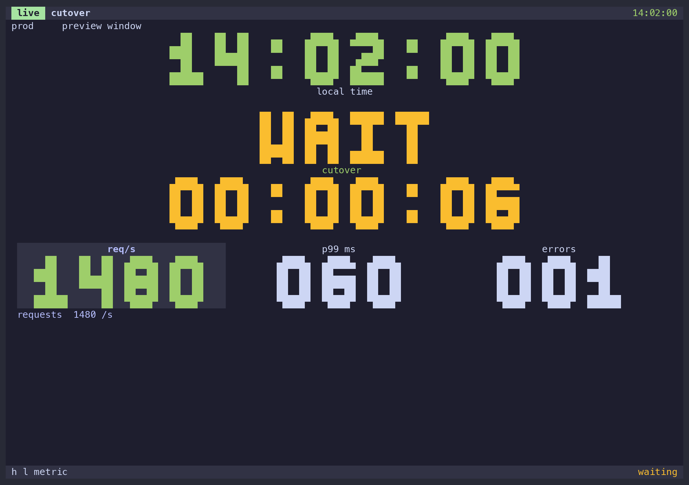

Screenshot: [docs/media/bigtext.png](docs/media/bigtext.png). Recorded with `scripts/record-showcase.sh` (`CASE=bigtext`, 120×36 at 2x scale, `FRAMES=330`, dark, lossless animated WebP, about 13 seconds).

### Image

A media library for an observatory archive. Each thumbnail is an `Image` with `ImageFit::Cover`. The selected one is drawn focused, and the two imports are drawn disabled until they finish. The preview switches between `ImageFit::Contain` and `ImageFit::Cover`, and the details panel shows each frame's tone bands. The pictures are the website's sky, hills and moon art, resized, tinted and layered by the example.

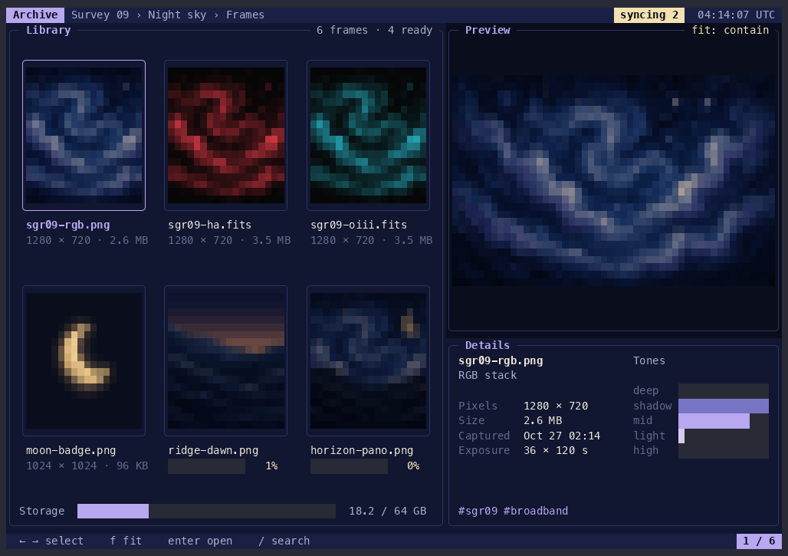

Screenshot: [docs/media/image-120x36-truecolor-dark.png](docs/media/image-120x36-truecolor-dark.png). Recorded with `scripts/record-widget.sh` (`CASE=image`, 120×36, dark, 10 seconds at 30 fps). The recording shows the half-block cell fallback, two image pixels per cell. The recorder captures terminal text and cannot capture Kitty graphics, so the Kitty path is not shown.

### Nested menu

An editor opens File, steps past a disabled Save item, and opens Recent. Selecting `metrics.rs` changes the active buffer; the edit is typed into the document and saved, updating the activity log and source-control status. Every panel, menu, code line, cursor and status row comes from real widgets.

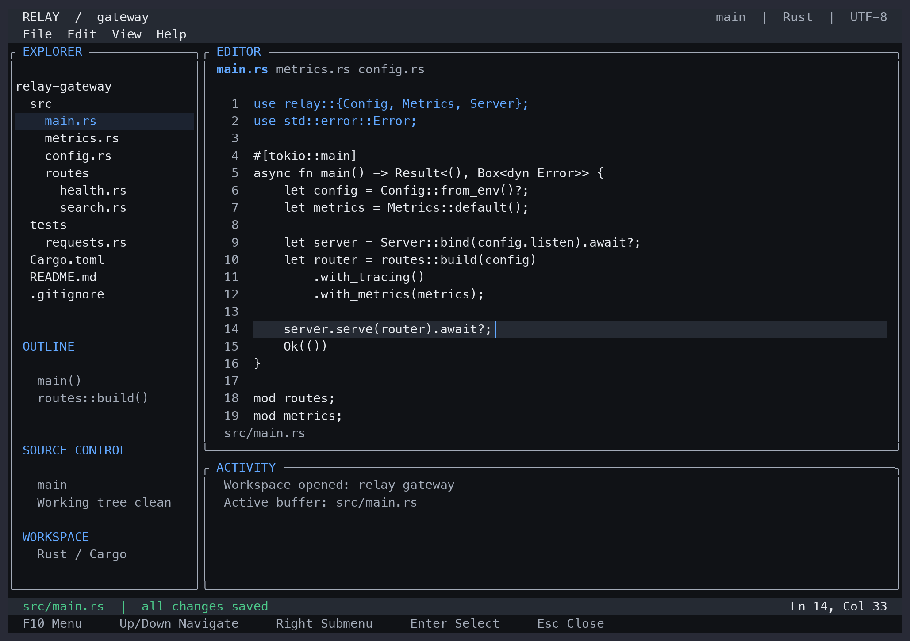

Screenshot: [Recent submenu over the editor](docs/media/nested-menu.png), taken at 3.8 seconds. Recorded at 120×36 and 2× scale in the dark theme with `CASE=menu-editor FRAMES=300 FPS=30 LAST_FRAME_DURATION=1 MAX_BYTES=2000000 scripts/record-showcase.sh`, as a lossless animated WebP, about 11 seconds.

Widget-parity Lunatui and Ratatui recordings: truecolor dark at [80×24](docs/media/nested-menu-80x24-truecolor-dark-side-by-side.mp4) and [200×60](docs/media/nested-menu-200x60-truecolor-dark-side-by-side.mp4), ANSI16 light at [80×24](docs/media/nested-menu-80x24-ansi16-light-side-by-side.mp4) and [200×60](docs/media/nested-menu-200x60-ansi16-light-side-by-side.mp4). Screenshots: [truecolor dark](docs/media/nested-menu-80x24-truecolor-dark.png) and [ANSI16 light](docs/media/nested-menu-80x24-ansi16-light.png). Reproduce with `CASE=nested-menu WIDTH=80 HEIGHT=24 PROFILE=truecolor THEME=dark FRAMES=180 FPS=30 scripts/record-widget.sh`, changing the size, profile, and theme for each variant.

### Popup and ScrollView

A release console. The build log is a `ScrollView` wider and taller than its pane, scrolled and panned with both scrollbars. A deploy `Popup` opens over a faded backdrop, the choice moves to Deploy, and the dialog is dragged aside. After the confirm, new log lines fill the last page and the services roll to the new build. An alerts `Popup` then opens above its status-bar chip with a scrolling `ScrollView` inside.

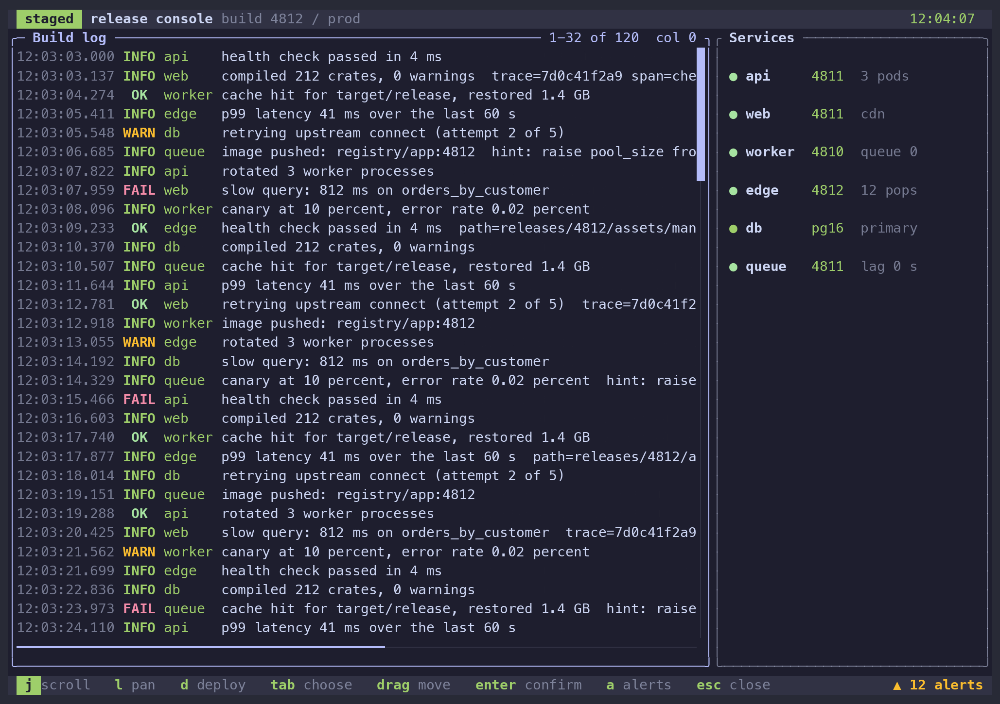

Screenshot: [docs/media/popup-scrollview.png](docs/media/popup-scrollview.png). Recorded with `scripts/record-showcase.sh` (`CASE=popup-scrollview`, 120×36 at 2× scale, 240 frames at 30 fps, dark, lossless animated WebP, about 10 seconds).
