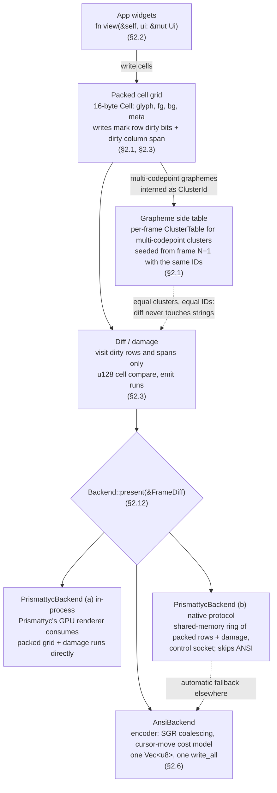

# lunatui architecture: per-frame flow

This is a summary of [PRD](PRD.md) §2 (Core architecture). The PRD is the source of truth. Section references below point to it.

## Stages

1. **App widgets (§2.2).** Apps write `fn view(&self, ui: &mut Ui)` each frame, as in ratatui. Behind the immediate-mode API, the core keeps grid damage, keyed memoization and an ID map. A memoized subtree whose hash and rect are unchanged keeps its previous cells and marks no damage.
2. **Packed cell grid (§2.1, §2.3).** Each cell is 16 bytes (`glyph`, `fg`, `bg`, `meta`, each `u32`), compared as one `u128`. The front buffer is retained, not reset. Every write marks the row dirty and widens its `[min_x, max_x)` span in O(1). Width is computed once at write time and stored. Wide graphemes use a lead cell plus a continuation cell.
3. **Grapheme side table (§2.1).** A single-scalar grapheme is stored inline in the 4-byte glyph slot. Multi-codepoint clusters are interned into the per-frame `ClusterTable` and stored as a tagged `ClusterId`. Table N is seeded from N−1's live entries with the same IDs, so equal clusters have equal IDs in consecutive frames. On overflow the frame falls back to a full re-intern and full diff.
4. **Diff / damage (§2.3).** The diff visits only dirty rows, and within them only the dirty span. It compares `u128` cells and emits runs of contiguous changed cells. Full invalidation (resize, theme change without token colors, explicit `invalidate()`) falls back to a full diff.
5. **Backend (§2.12).** `Backend::present` receives the `FrameDiff` (runs, cursor, ext ops).
   - **`AnsiBackend` (§2.6):** the default for Unix TTY and Windows VT. Dirty runs go through the encoder into one reusable `Vec<u8>` and one `write_all`, wrapped in synchronized update (`CSI ? 2026 h … l`) when DECRQM reports support.
   - **`PrismattycBackend`, in-process:** Prismattyc's own GPU renderer consumes the packed grid and damage runs directly, for its chrome.
   - **`PrismattycBackend`, native protocol:** an app running inside Prismattyc negotiates a side channel (shared-memory ring of packed rows plus damage, with a control socket) and skips ANSI, with automatic fallback to `AnsiBackend` elsewhere. Per D12, the in-process sink comes first and the native protocol is specified in Phase 8.

`TestBackend` (in-memory grid plus encoder transcript) is also listed in §2.12 for snapshots and the vt100 oracle. It is not shown in the diagram.
