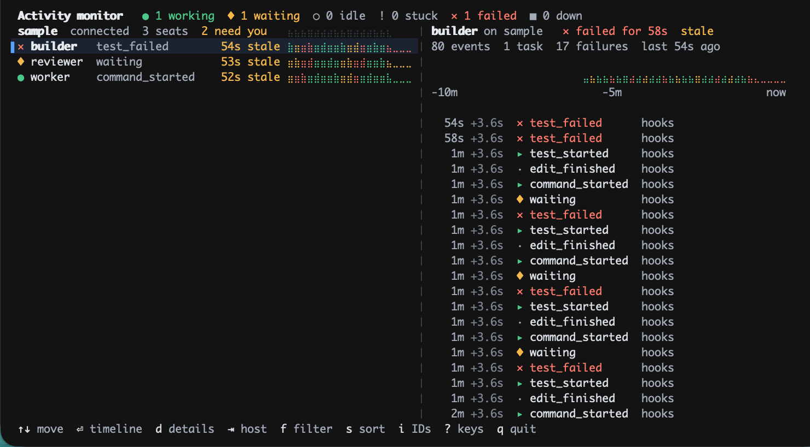
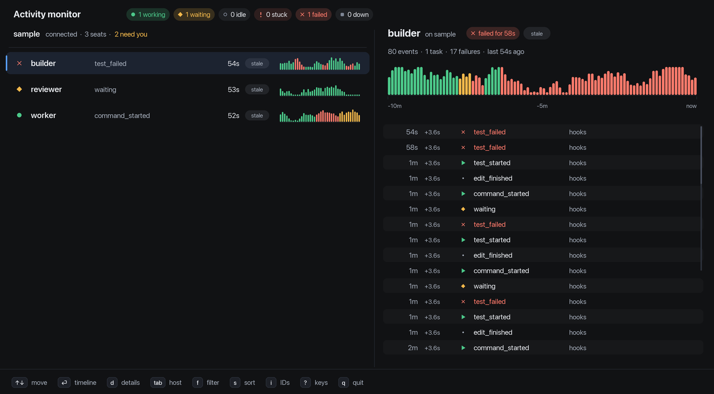
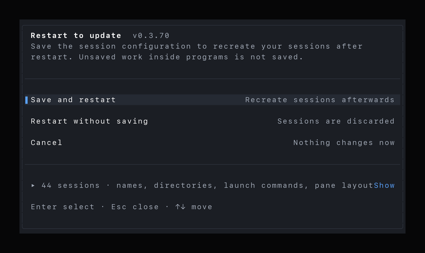
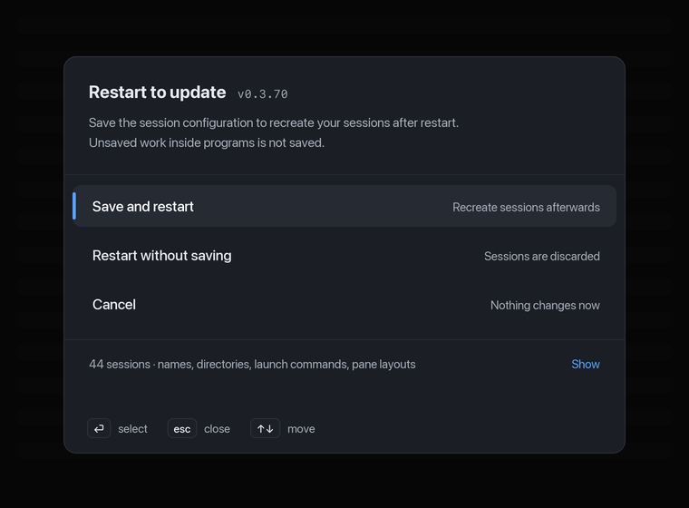

# Graphite mode: design note

Status: proposal for the owner's review. Nothing here is implemented, and no public API changes until it is approved.

lunatui is not meant to be strictly monospace cell blocks. This note proposes two rendering modes for the same widgets and the same application code:

- **Cell mode** draws terminal character cells, as lunatui does today.
- **Graphite mode** draws smooth pixels: proportional text, true rounded borders, continuous charts and real translucency.

Graphite is the look of the existing Graphite crate and of Prismattyc's chrome. The mode and the look are separate: Graphite mode says how a widget is drawn, and the theme tokens say what colors and sizes it uses.

## The demo: the activity monitor in Graphite mode

The activity monitor is the demo because it is an app people read all day, and it already pushes against cells: its lanes are strips of time bins drawn with braille dots or an opt-in pixel raster, and its header, chips and key hints are text standing in for shapes.

| Cell mode (real capture) | Graphite mode (mockup) |
|---|---|
|  |  |

The left picture is a real capture of the monitor in Cell mode. The right picture is a hand-composed mockup, not lunatui output: `scripts/graphite-mode-mockups.py` draws it from the same data (the same seats, states, ages and timeline), so the two can be compared line by line. The lane bin heights in the mockup are invented.

What changes, element by element:

| Element | Cell mode | Graphite mode |
|---|---|---|
| Header counts | Glyph and text in the cell font | Pill chips tinted by state, with a drawn dot, diamond or cross |
| Seat rows | Text columns, highlight as a cell background | Proportional text, a rounded selection with a 3 px focus bar, a `stale` tag as a small pill |
| Lanes | Braille dots, or an opt-in pixel raster | Rounded bins whose height is the activity in that bin, on a hairline baseline |
| Timeline | Monospace columns | Proportional rows with right-aligned ages and a slim scroll thumb |
| Key hints | `↑↓ move` as text | Keycap shapes and labels |

What does not change: the data, the state rules, the keys, the focus order and every named control. A person or an agent drives both modes the same way.

## Where lunatui stands today

The pieces exist, but there is no mode concept that joins them.

- **Pixel widgets.** `pixel-gauge`, `pixel-chart`, `pixel-sparkline`, `pixel-pie-chart`, `pixel-canvas`, `pixel-barchart`, `pixel-progress` and `pixel-node-graph` are on by default. Each submits an RGBA image through `RenderFrame::parts` and the `ImageSink` (`lunatui-image`, `lunatui-term/src/pixel.rs`), and each keeps a cell fallback that draws when the sink declines.
- **Alpha and sub-cell.** [ADR 0009](adr/0009-native-alpha-subcell.md) gives a cell optional alpha and an eighth-cell offset when a native host affirms it. Widgets already write their cell approximation too, so the layout is the same with or without the host.
- **A Graphite bridge.** `lunatui-widgets::graphite` has pixel rectangles, `CellSize`, a `Face` and a `TextMetrics` trait with a fixed-column `CellTextMetrics`, and, behind `symbol-font-fallback`, `HostTextMetrics` for host fonts ([host symbol fonts](symbol-font-fallback.md)). The host owns font discovery, shaping and drawing.
- **Image transport.** [The ABI 1.2 image protocol](native-image-protocol.md) carries immutable RGBA sources of up to 64 MiB and explicit placements to a native host. It is proposed, and the host side is not built yet.
- **The Graphite crate** is renderer-agnostic: tokens, geometry, scale and translucency rules. Prismattyc draws its own chrome with it, which is why the window chrome in the capture above already looks Graphite while the monitor inside it does not.

## Mode selection

Three inputs decide the mode of a frame. The last one wins.

1. **The backend's capability.** A backend says whether it can show pixels, and how: cell size in pixels, whether it draws proportional text, whether it composites alpha. A plain terminal reports none. The Prismattyc native backend reports all three once the host work lands. A terminal with a pixel graphics protocol can report pixels without proportional text.
2. **The application's policy:** `Auto` (default), `Cell` or `Graphite`. `Auto` picks Graphite exactly when the backend can do it, and `Graphite` on a backend that cannot falls back to Cell.
3. **A person's override:** an environment variable and, where an app offers one, a setting. This is for debugging and for people who prefer cells.

A widget may override its own mode (for example a chart that is always pixels). The result is always `effective = policy ∩ capability`, never a failure: Cell mode is the floor. The mode can change while the app runs, for instance when the window moves to another backend, and a change repaints everything once.

The layout is the same in both modes. Widgets receive a rectangle in cells, as now, and draw inside it. Focus order, the hit map, scrolling and wrapping stay in whole cells, the rule [ADR 0009](adr/0009-native-alpha-subcell.md) already set. This is what keeps an ANSI frame and a Graphite frame consistent, and it is what keeps agents and accessibility export unchanged.

## How Graphite output is produced

Two ways to get pixels onto the screen, with different costs:

- **A. lunatui rasterizes, the backend shows images.** Widgets draw into a CPU raster owned by lunatui. Changed regions go out as images through the existing `ImageSink`, or through the ABI 1.2 image protocol in the native host. It works on any backend that can show images, and it needs no new protocol. The cost is that lunatui owns text drawing, so it needs a font and a shaper, and it sends pixels.
- **B. lunatui sends a scene, the host rasterizes.** Widgets emit primitives (rounded rectangle, stroke, text run, image, clip, opacity) and the host draws them with its own fonts and renderer. Text is exact because the host measured and shaped it, translucency is real, and resolution does not matter. The cost is a new protocol revision and host work, and it only works where a host exists.

**Proposal: build A first, design for B.** A is the only way to put Graphite mode in front of the owner without waiting on the host, and it also serves terminals with a pixel protocol. B is where the quality and the frame budget end up, so the widget-facing API is a primitive list from the start; A is one consumer of that list and B is another. The proposal needs the owner's approval because A makes lunatui carry a font.

## API sketch

The mode, policy and capability types below are implemented in `lunatui-runtime` (`RenderMode`, `ModePolicy`, `GraphiteCaps`, `Capabilities`, `RunOptions::mode` and `RenderFrame::mode`), with no behavior change: no backend reports Graphite yet, so every frame is Cell. `PixelCx` and `RenderCx::paint_pixels` are implemented in `lunatui-widgets` (feature `pixel-cx`, on by default) and paint only in Graphite mode. Glyph rasterization waits for the bundled font.

```rust,ignore
pub enum RenderMode { Cell, Graphite }
pub enum ModePolicy { Auto, Cell, Graphite }

pub struct Capabilities {
    pub graphite: Option<GraphiteCaps>,
}

pub struct GraphiteCaps {
    pub cell_px: CellSize,
    pub proportional_text: bool,
    pub alpha: bool,
}

impl RenderCx<'_> {
    pub fn render_mode(self, mode: RenderMode) -> Self;
    pub fn paint_pixels(
        &mut self,
        area: Rect,
        depth: i32,
        paint: impl FnOnce(&mut PixelCx<'_>),
    ) -> bool;
}
```

- The mode travels in `RenderCx`, not in a second `Widget` method. Applications render their own widget trees by calling `render` on children, so nothing could call a separate `render_graphite`. A widget calls `paint_pixels` from `render`. Every existing widget keeps working in Graphite mode unchanged, drawn in cells. Widgets adopt pixels one at a time.
- `paint_pixels` paints only when the frame is in Graphite mode, the image sink takes pixels and the area is within the pixel limits. Otherwise it returns `false` having drawn nothing and changed no cell, and the widget draws its Cell form.
- `PixelCx` offers the primitives: filled and stroked rounded rectangles, lines and areas, with text measured and fitted by a `TextMetrics`. Bars, images and glyph runs come next. A Graphite widget also writes its Cell approximation into the cells underneath, as the alpha work does, so a frame that has to fall back loses detail and not layout.
- Text is measured with the same `TextMetrics` trait that exists now. Cell mode uses `CellTextMetrics`; Graphite uses host metrics, or a bundled font under option A. A label that does not fit is cut by pixel width with an ellipsis, not by column count.
- Named controls, the agent API and the accessibility export are mode-independent. They read the registry, not the pixels.
- Hit testing stays on the cell hit map. Pointer events that carry pixel coordinates refine it with a pixel offset inside the hit cell, for controls that need it (sliders, resize handles).

## The 8 ms frame ceiling

The product requirement is a maximum frame time of 8 ms on a dedicated machine as a target and 16 ms as the CI gate, measured on every sample of every worst-case benchmark, end to end including encode and write.

Graphite mode makes that harder, and the arithmetic shows how:

| Surface | Pixels |
|---|---|
| A 1480 by 818 window at 1x | 1.2 million |
| The same window at 2x | 4.8 million |
| A 4K display | 8.3 million |

Repainting a 4K frame on the CPU at even one pixel per nanosecond would use the whole 8 ms before encoding anything. So the rule is: **a Graphite frame never repaints more than it changed.**

- Widgets track damage in cells, as now. Graphite output is rasterized per damaged cell region and cached per widget; unchanged regions are reused by source identity and generation, which is what the image protocol's resource keys are for.
- The activity monitor is a good case: a poll changes a few rows and the lanes' last bins, not the screen.
- The budget is split, and each part is a target to be measured, not a result: building the primitive list stays at the cost Cell mode already has, rasterizing the damaged region gets the largest share, and present or encode gets a fixed share, with the rest left as headroom.
- Full repaints (first frame, resize, mode change) are the worst case and are measured separately. A mode change should not need a full-resolution repaint in one frame; it can fade or tile over a few frames, as long as no single frame is over the ceiling.

The first piece of work is a spike that measures real numbers on the activity monitor and a worst-case scene before any API is frozen: raster time per damaged area at 1x and 2x, encode and transport cost for each image path, and the full repaint. The existing benchmark harness gains Graphite cases, gated on a deterministic measure instead of a single wall-clock ratio, since that gate is already known to be noisy.

## Relation to the Graphite crate, the product requirements and the native backend

- **The Graphite crate.** `graphite-core` stays renderer-agnostic and keeps owning tokens, geometry, scale and translucency rules. lunatui consumes them for the Graphite mode theme and does not copy them. Prismattyc keeps drawing its chrome with the same crate, so the window and the app inside it finally share one language.
- **The product requirements.** Decision D11 says lunatui stays look-neutral and Graphite is an optional feature. This proposal keeps the look in the theme, but adds a render mode to the core. D11 needs an amendment: Graphite mode is part of lunatui, selectable at run time, and the Graphite look remains a token set.
- **The native backend (Phase 8).** The protocol and image transport are the base for option A in the native host. A scene section for option B would be a later protocol revision and is not part of the work that is in flight. Until the host exists, the native host path is off by default under the existing opt-in and release-candidate plan, and Graphite mode there is off with it.

## Proof and tests

- **Layout parity.** The same widget tree must produce the same cell layout, focus order, hit map and named controls in both modes. A test renders each widget in both modes and compares them.
- **Real events.** Interactive widgets are tested through `lunatui_test::Harness` with real events in both modes.
- **Raster goldens.** Graphite output is rasterized with integer math so a golden image is deterministic, and goldens are reviewed as images, not regenerated blindly.
- **Fallback.** A backend that declines pixels must leave Cell mode output byte-identical to today. This is checked on every widget that adopts Graphite.
- **Mode selection.** Tests cover capability, policy and override, including a mode change at run time, with a virtual clock and no sleeps.
- **Frame ceiling.** Each Graphite worst case is added to the benchmark suite and measured at 1x and 2x.
- **Pictures.** A Graphite widget PR ships a real-output capture, and a README capture where the README shows widgets. The mockups in this note are the only hand-composed pictures and are labeled as such.

## Rollout

The compiled-in feature and the API ship on by default, as every lunatui feature does. The behavior does not change anywhere until a backend reports a pixel capability, because `Auto` resolves to Cell without one. The native host path keeps its own default-off flag until its release-candidate and owner-trial steps are done. Making Graphite the default for a given backend is a separate, reviewed decision.

## Questions for the owner

1. **Option A first, then B**, or wait for B only? A means lunatui carries a font.
2. **Which font** for option A: a bundled open-licensed UI font, the platform font, or host fonts only (which limits A to the native host)?
3. **Which backends count** for the first demo: the native host only, or also terminals with a pixel protocol?
4. **Amend D11** as described above?
5. **The frame ceiling for a full repaint**: is a tiled or faded mode change acceptable, or must a full repaint fit in one frame?

## Secondary mockup: the restart dialog

The Prismattyc restart dialog prototype (the `feature/lunatui-restart-dialog` branch) draws the dialog with lunatui widgets in Cell mode. At 72 columns the summary line runs into the `Show` link, which is the monospace constraint: the text is cut by columns and has no ellipsis.

| Cell mode (the prototype's real cells) | Graphite mode (mockup) |
|---|---|
|  |  |

The left picture is drawn from the grid the prototype's `Block` and `Accordion` produced, stored as `media/graphite-mode/restart-dialog-cell-grid.json`. The right picture is a mockup in the style of Prismattyc's existing pixel dialog: a rounded panel with a soft shadow, hairline rules, a rounded selection with a focus bar, keycap hints, and text that is measured and not counted in columns.

## Proposed work, if approved

1. A spike that measures the frame budget on the activity monitor and a worst-case scene.
2. The mode, policy and capability types, with no behavior change.
3. `PixelCx`, the primitive list and text measurement.
4. The activity monitor's lanes, chips and rows in Graphite mode, as the first adopter.
5. Pixel refinement of the hit map for controls that need it.
6. Graphite cases in the benchmark suite on a deterministic gate.
7. Later, a scene section for the native protocol (option B).
