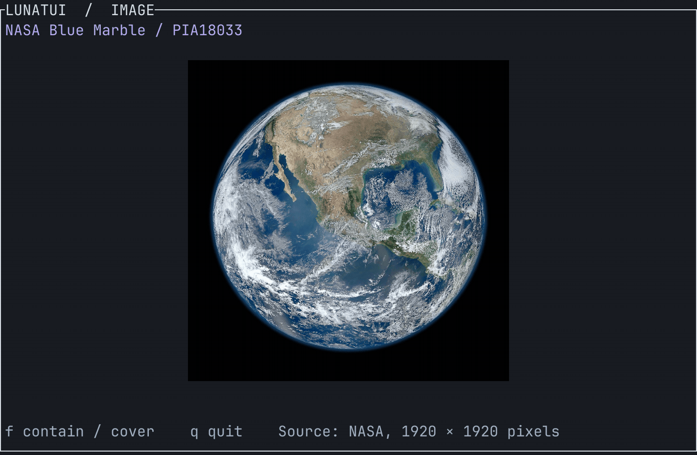

# Verify native image presentation

The native image transport is experimental and is advertised only by an eligible direct local
Prismattyc session started with `--experimental-rich`. A normal terminal, forwarded session, or
host without that capability uses the existing Kitty, iTerm2, Sixel, or cell fallback.

## Automated checks

From the repository root, run the resource lifecycle test and the runtime builds with and without
the default image presenter:

```sh
cargo test --locked -p lunatui-prismattyc --test native_image_sink
cargo check --locked -p lunatui-runtime
cargo check --locked -p lunatui-runtime --no-default-features --features app
```

The lifecycle check asserts that a pending upload is not placed, a READY heartbeat makes the
image visible, a source being prepared is not queued twice, and omission permits retirement.

## Live host check

Use a clean macOS Apple Silicon or supported Linux VM with the Prismattyc native image host
enabled. Build the example at the revision under review and run it as a direct local child in
that host:

```sh
cargo run --release -p lunatui --features image-presenter,image-decode --example kitty_image
```

The example starts at the attached terminal's current dimensions. Wait for the Blue Marble image
to render, press `f` to switch Contain/Cover, and press `q` to exit. Capture the actual host
window or its recorded output. The proof must name the source revision and VM OS, show the command,
and confirm the image rendered through the native host path. A standalone Kitty capture exercises
the fallback presenter and does not prove native presentation.

The clean macOS VM capture for this implementation is shown below. The still and GIF come from the
Prismattyc framebuffer over VNC; no host Screen Recording permission is needed.


