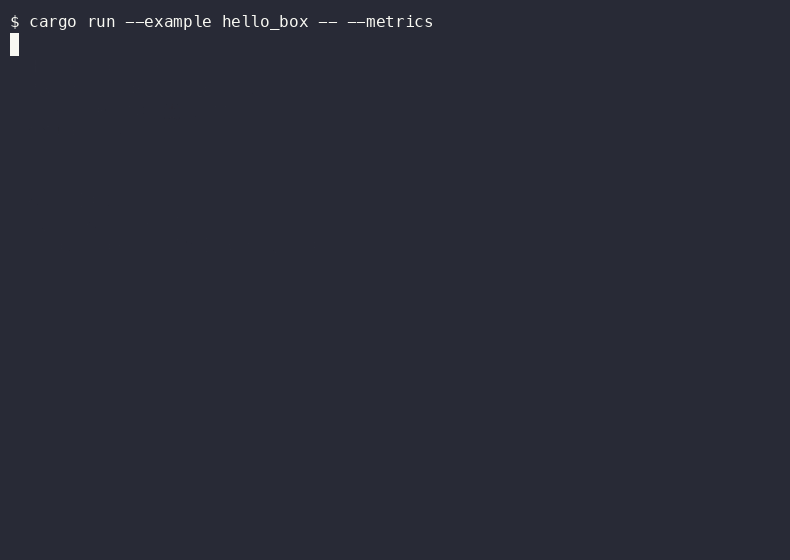
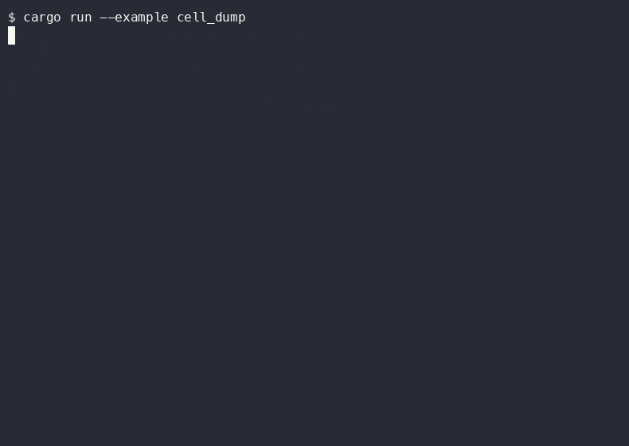
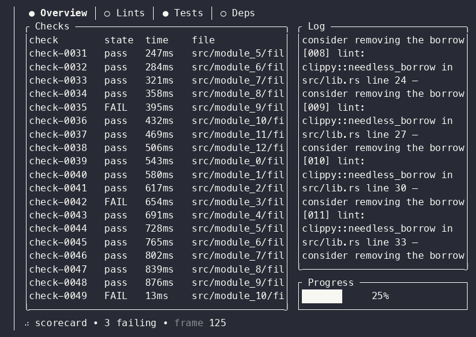
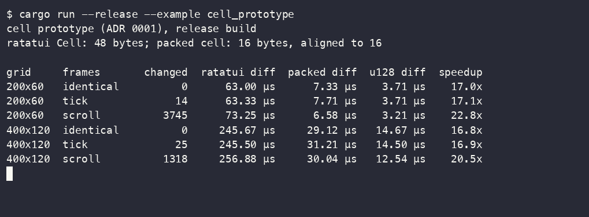
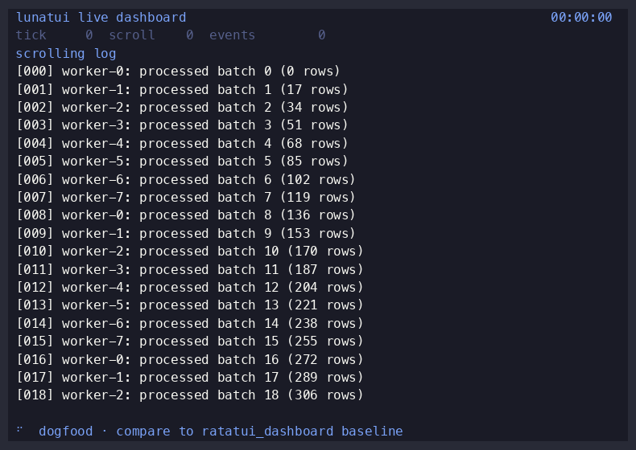
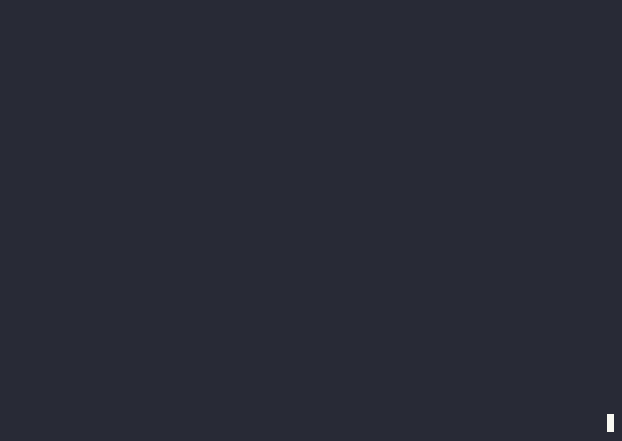
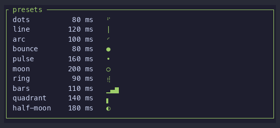

# lunatui examples

Each example runs from the repository root with one command (PRD M13). Start with the [quickstart](../docs/getting-started.md). The copy-paste templates below are the short programs. `hello_box`, `gallery`, `demo`, and `live_dashboard` are the longer demos.

## Templates

| Example | Command | Shows | Last changed |
|---|---|---|---|
| `template_minimal` | `cargo run --example template_minimal` | A titled box. Press `q` to quit. `--snapshot` prints one frame. | quickstart |
| `template_list` | `cargo run --example template_list` | A list. Up and down move the selection. `--snapshot` prints one frame. | quickstart |
| `template_form` | `cargo run --example template_form` | Two fields. Tab moves focus, and typed keys edit the focused field. `--snapshot` prints one frame. | quickstart |
| `template_dashboard` | `cargo run --example template_dashboard` | A sparkline, a gauge, and a table. The samples advance while the example runs. `--snapshot` prints one frame. | quickstart |
| `template_popover` | `cargo run --example template_popover` | A panel beside an anchor. Enter toggles it. `--snapshot` prints one frame with the panel open. | quickstart |
| `template_layout` | `cargo run --example template_layout` | Header, sidebar, body, and a status bar. `--snapshot` prints one frame. | quickstart |

The source for each row is `templates/<name>.rs` without the `template_` prefix (`templates/minimal.rs` for `template_minimal`). Captures of those frames are on the [quickstart page](../site/quickstart.html).

| Example | Command | Shows | Last changed |
|---|---|---|---|
| `gallery` | `cargo run --example gallery` | Phase 4 widget gallery: Paragraph/List/Table plus Tabs, Gauge, Scrollbar, Spinner, `StatusBar`, `TextInput`, and `Overlay` modal (PRs 30–33). Piped stdout: `--snapshot` for a text frame (M13 capture in `captures/gallery.cast`). | PR 34 |
| `keymap` | `cargo run --example keymap --features keymap` | Interactive shortcut overlay and command palette; the release-console screen shows a `KeyHintBar` from its active keymap. `--snapshot` prints the shortcut overlay and palette frames. | key-hints |
| `demo` | `cargo run --example demo --features app` | Hello-world on `lunatui::run()` (PR 23, `app` feature). Interactive `run()` works on Unix and Windows Terminal (PR 27). `--counter` adds clickable/focusable `[ - ]` / `[ + ]` buttons with `HitMap` + `FocusManager` (PR 24). `--motion` (with `--counter`) animates the value with a spring and accent tween (PR 25). Counter mode uses theme tokens; default bundled `prismattyc-dark`; press `t` to toggle prismattyc light/dark (PR 26). Counter UI is framed with `lunatui_widgets::Block` (PR 29); title row still shows `StatusDot` via `RenderCx` (PR 28). `--ratatui-bridge --snapshot` draws the ratatui dashboard scene through `lunatui_ratatui::LunatuiBackend` (PR 43). `--porting --snapshot` shows the three L2 port patterns (PR 46). `--simd --snapshot` prints runtime SIMD dispatch level and differential harness probe (PR 47), and ASCII log width bench (PR 49). `--encode-bench --snapshot` times 256× `Encoder::encode_diff` on dashboard-like frames (PR 50). Piped stdout: `--snapshot` or release bench (`--width` / `--height`). | PR 50 |
| `widget_preview` | `cargo run --release --example widget_preview --features color-profiles -- --case block --side lunatui --profile ansi16 --theme light` | One widget from the parity suite, drawn at a fixed frame rate on either side, for recordings. Flags: `--case`, `--side lunatui\|ratatui`, `--profile truecolor\|ansi256\|ansi16`, `--theme dark\|light`, `--width`, `--height`, `--frames`, `--fps`. | recording |
| `image_showcase` | `cargo run --release --example image_showcase --features image-decode -- --width 120 --height 36 --frames 300 --fps 30` | Dark media library: `Image` thumbnails (focused, disabled while importing), a preview that switches between contain and cover, and tone bands, drawn with the `Image` cell fallback. `--snapshot` prints the first frame as text. | Image gallery |
| `kitty_image` | `cargo run --release -p lunatui --features image-presenter,image-decode --example kitty_image` | NASA's sharp 1920×1920 Blue Marble Earth (PIA18033) through the `Image` widget and Kitty graphics protocol when available; other terminals use the cell fallback. Credit: NASA. Press `f` to switch Contain/Cover and `q` to exit. Record actual pixels with `WIDTH=100 HEIGHT=32 KEYS=2:f,5:f scripts/record-pixels.sh`; see [the recording guide](../docs/recording-pixels.md). | Image gallery |
| `pixel_pie_chart` | `cargo run --release -p lunatui --features image-presenter --example pixel_pie_chart` | Antialiased regional traffic donut using the shared image presenter, with automatic Braille fallback. Use arrows to select a region, Space to hide or restore the chart, and `q` to quit. Run in a 100×32 terminal. Add `-- --compare` for mirrored Braille and pixel charts using the same data and layout. | Pixel `PieChart` |
| `pixel_chart` | `cargo run --release -p lunatui --example pixel_chart` | Requests, Saturation CPU/memory, latency scatter, and hourly bars from the same shared scenes as the preview. Braille and pixel versions share data and layout. Arrows change the chart, `u` advances the sample, and `q` quits. Run in a 100×32 terminal. | Pixel `Chart` |
| `pixel_canvas` | `cargo run --release -p lunatui --example pixel_canvas` | Six shared Canvas scenes with equal-size, same-tick Braille/pixel views. Arrows change scenes, `u` advances the held sample, `b` switches the right pane to cells and back, and `q` quits. Run in a 120×36 terminal. | Pixel `Canvas` |
| `pixel_bar_chart` | `cargo run --release -p lunatui --example pixel_bar_chart` | Grouped requests, regional latency, build runs, and queue states from the shared preview scenes, with equal-size Cells/Pixels panes. Arrows change scenes, `u` advances the sample, `b` switches the right pane to cells and back, and `q` quits. Run in a 168×36 terminal. | Pixel `BarChart` |
| `pixel_sparkline` | `cargo run --release -p lunatui --example pixel_sparkline` | The shared service board with ten lanes and a selected inspector, in equal-size Cells/Pixels panes. Arrows select CPU, Network, Requests, Errors, Cache and Connections scenes. `u` advances the sample, `b` switches the right pane to cells and back, and `q` quits. Run in a 200×44 terminal. | Pixel `Sparkline` |
| `bigtext` | `cargo run --example bigtext -- --snapshot` | Three themed readings (normal, focused, disabled) of large half-height text. `--snapshot` prints the frame as text. | bigtext |
| `calendar` | `cargo run --example calendar -- --snapshot` | Three themed months (normal, focused, disabled) for October, with styled event days. `--snapshot` prints the frame as text. | calendar |
| `sparkline` | `cargo run --example sparkline -- --snapshot` | Three themed sparklines (normal, focused, disabled) over a sliding request-rate series. `--snapshot` prints the frame as text. | sparkline |
| `spinner_presets` | `cargo run --example spinner_presets -- --snapshot` | A production deploy board: image, checks, and canary cards, a task list, an event log, and a rollout gauge. `--width`, `--height`, `--frames`, and `--fps` play the screen. `--snapshot` prints the first frame as text. | presets |
| `port_ratatui_block` | `cargo run --example port_ratatui_block -- --snapshot` | Side-by-side lunatui `Block` and ratatui `Block` through `RatatuiWidget` (PR 46 porting guide). | PR 46 |
| `port_ratatui_paragraph` | `cargo run --example port_ratatui_paragraph -- --snapshot` | ratatui `Paragraph` with styled spans inside lunatui chrome (PR 46). | PR 46 |
| `port_ratatui_list` | `cargo run --example port_ratatui_list -- --snapshot` | Stateful ratatui `List` via `RatatuiStatefulWidget` (PR 46). | PR 46 |
| `layout_prototype` | `cargo run --example layout_prototype` | The ADR 0002 closed-form split. A fixed 10 and a fixed 8 stay put when the row grows from 40 to 80, and the two fill panes take the extra cells at weights 1 and 2. Twenty `Fill(1)` panes at width 200 are 10 each, with no solver fallback. | DD-2 |
| `keys` | `cargo run --example keys` | Decoded key, mouse, paste and focus events from a captured byte stream (PR 20). A terminal shows that capture. Piped stdin is decoded instead when it is non-empty. | PR 20 |
| `live_dashboard` | `cargo run --release --example live_dashboard -- --bench --width 200 --height 60 --frames 240` | Dogfood dashboard with a simulated clock, counters, scrolling log and spinner. Interactive mode uses `lunatui_runtime::Scheduler`; headless `--bench` runs fixed frames without pacing and prints lunatui and Ratatui 0.30.2 p50/p99/max side by side at the same size and frame count. Both include diff, encoding and an in-memory writer. | dogfood item 1a |
| `gradient` | `cargo run --example gradient --features color-profiles` | A hue ramp in four profiles, each step a colored swatch: truecolor, xterm 256, ANSI 16, and black or white. The 16-color row keeps distinct hues. The feature stays off unless this command turns it on. | PR 30 |
| `caps` | `cargo run --example caps` | The probed `Caps` in a box: color, DEC modes 2026 and 2027, keyboard and graphics, the width fallback, and the terminal name (PR 12). On a terminal it runs the 200 ms probe and enables mode 2027 when the terminal reports it reset. Piped stdout uses the environment only. | PR 12 |
| `hello_box` | `cargo run --example hello_box -- --metrics` | A bordered box with text, including CJK, Hangul, an emoji, an accented letter, and a line of ZWJ emoji, VS16 and a flag cluster whose right border stays aligned because each line is measured with `lunatui_core::width` (PR 04–05). The frame uses `lunatui_widgets::Block` on a `lunatui_core::Grid` (PR 29). With `--encode` it emits the frame through `lunatui_term::Encoder` (PR 09). With `--session` it presents that frame through `lunatui_term::Session` in the alternate screen with synchronized output and restores on exit (PR 10, Unix). With `--oracle` it checks the vt100 oracle on the diff between the previous demo frame and this one (PR 11). With `--diff` it diffs two frames with `lunatui_core::diff_runs` and prints the changed runs (PR 08). With `--cells` it prints packed `lunatui_core::Cell` words for sample glyphs (PR 06). With `--metrics` it also shows what drawing the box cost (`write()` calls, bytes, allocations), measured with the bench harness counters. | PR 29 |
| `cell_dump` | `cargo run --example cell_dump` | Sample `Cell` values (blank, box corner, text and a wide lead) as 32-digit hex `u128` words, matching ADR 0001 layout (PR 06). | PR 06 |
| `ratatui_dashboard` | `cargo run --release --example ratatui_dashboard` | The ratatui baseline dashboard scene (PR 03), drawn live on ratatui 0.30.2 for 240 frames at about 60 fps. It then prints the draw-time p50, p99 and maximum against the 8 ms frame target, naming the build profile, because only a release build is a fair number. This is the scene lunatui is measured against. | PR 03 |
| `cell_prototype` | `cargo run --release --example cell_prototype` | The evidence for ADR 0001 (DD-1). It packs PR 03's dashboard frames into 16-byte prototype cells, checks that the packed diff finds the same changed cells as ratatui, and compares diff times: ratatui's 48-byte cells, the packed struct, and rows stored as `u128` words. | DD-1 |

Captures (M13) live in `captures/`. A `.png` shows the final screen, and a `.cast` replays with `asciinema play`. `captures/hello_box.cast` is `cargo run -q --example hello_box`. `captures/hello_box_oracle.cast` is `cargo run -q --example hello_box -- --oracle`. `captures/caps.cast` is `cargo run -q --example caps` with `TERM=xterm-256color`, `COLORTERM=truecolor`, and `TERM_PROGRAM=Apple_Terminal` (not a tty, so the box shows the ambiguous-wide fallback). `captures/gradient.cast` is `cargo run -q --example gradient --features color-profiles`. `captures/layout_prototype.cast` is `cargo run -q --example layout_prototype`. `captures/keys.cast` is `cargo run -q --example keys`. `captures/live_dashboard.cast` is `cargo run -q --example live_dashboard -- --width 80 --height 24 --frames 1` in a pty; `captures/live_dashboard.png` shows the rendered frame. Paired headless bench: `cargo run --release --example live_dashboard -- --bench --width 200 --height 60 --frames 240`.

`captures/demo.cast` is `cargo run -q --example demo --features app -- --counter --snapshot --width 80 --height 24`. `captures/demo.png` is a raster of that snapshot (Menlo on surface.0). `captures/demo_ratatui_bridge.cast` is `cargo run -q --example demo --features app -- --ratatui-bridge --snapshot --width 80 --height 24`. `captures/demo_ratatui_widget.cast` is `cargo run -q --example demo --features app -- --ratatui-widget --snapshot --width 80 --height 24`. `captures/demo_ratatui_style.cast` is `cargo run -q --example demo --features app -- --ratatui-style --snapshot --width 80 --height 24`. `captures/demo_porting.cast` is `cargo run -q --example demo --features app -- --porting --snapshot --width 80 --height 24`. `captures/demo_simd.cast` is `cargo run -q --example demo --features app -- --simd --snapshot --width 80 --height 24`. `captures/demo_encode.cast` is `cargo run -q --release --example demo --features app -- --encode-bench --snapshot --width 200 --height 60`. `captures/demo_grid_sink.cast` is `cargo run -q --release --example demo --features app -- --grid-sink --snapshot --width 200 --height 60`. `captures/port_ratatui_block.cast` is `cargo run -q --example port_ratatui_block -- --snapshot`. `captures/port_ratatui_paragraph.cast` and `captures/port_ratatui_list.cast` match their example names with `--snapshot`. Bench summary: `cargo run -q --release --example demo --features app -- --width 80 --height 24`.

`captures/gallery.cast` is `cargo run -q --example gallery -- --snapshot` (one rendered frame with overlay modal).

`captures/spinner-presets.gif` is `CASE=deploy WIDTH=120 HEIGHT=36 FRAMES=80 FPS=10 PROFILE=truecolor THEME=dark scripts/record-widget.sh`. The still from that clip is `captures/spinner-presets.png`.

Examples live in this directory and are registered as `[[example]]` targets of the `lunatui` facade crate (`lunatui/Cargo.toml`).

Benchmarks are separate: `cargo xtask bench` prints allocation and write metrics and runs the criterion and gungraun benchmarks in `benches/`.
