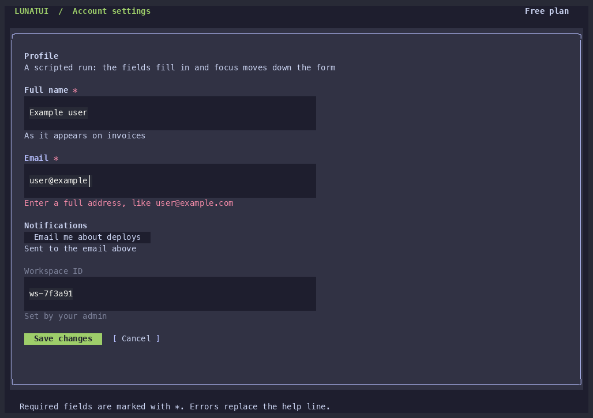

# lunatui-field

Field for lunatui. A [`Field`] puts a bold label above any control widget and keeps a muted help
line under it. An error message replaces the help line in the destructive color, a required field
marks its label with `*`, a focused field draws its label in the ring color, and a disabled field
dims. The control is any [`Widget`](lunatui_widgets::Widget), so a text input, a toggle or a
button sit in a field alike. All colors come from `lunatui-ui-tokens`.

## Named fields and forms

`Field` is the shared descriptor for a standalone stacked field and a row in
`Form`. Add `.id(HitId(...))`, or set `Form::first_id`, and render through
`RenderCx::hit_map` to register its accessible name, body role and disabled state.
An empty visual label requires `.name()`. Input values are never exported.

This recording uses the real `ui_field` widgets with an injected virtual clock.
Reproduce it with `python3 scripts/record-named-controls.py`. Each frame checks
all six named controls against their real accessibility JSON; the displayed
values and help/error messages remain absent from that export.

For composition, registration and the former `FormField` API, see
[the named-control migration guide](../docs/named-controls.md).
